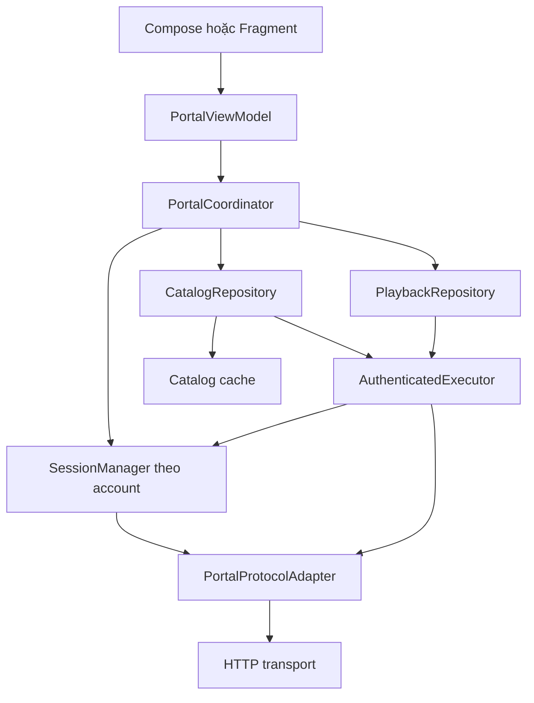
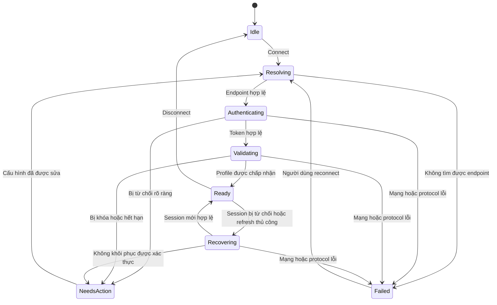

# Thiết kế connect, reload và phục hồi session portal cho Android

Ngày phân tích: 29/09/2026. Bản tham chiếu: SFVIP Player 1.2.5.7.

**Quyết định thiết kế:** dùng một bộ điều phối trạng thái kết nối, một SessionManager theo tài khoản và các adapter giao thức. Tách `connect`, `refreshSession`, `reloadCatalog` và `reconnect`; không coi mọi thất bại là lỗi xác thực.

## 1. Phạm vi và độ chắc chắn

Workspace chỉ chứa bộ cài đã biên dịch, không có project Android hoặc mã nguồn gốc. Tài liệu dựa trên C# khôi phục bằng ILSpy 9.1 từ `SFVIP-Player-x64/sfvip player.exe`, không chạy ứng dụng hay gửi request tới portal thật.

SHA-256 file thực thi: `21F6F42282198DD5D031D5A6044FBAC051CE73C3788B724872D4763714830415`.

Mã khôi phục nằm tại [sfvip player.decompiled.cs](../.analysis/decompiled/sfvip%20player.decompiled.cs). Tên hàm và chuỗi request bị làm rối. Các tên `handshake`, `validateProfile`, `resolveEndpoint` dưới đây là tên mô tả do tài liệu đặt theo kiểu dữ liệu và hành vi; chưa xác nhận nguyên văn URL/query/header đã mã hóa. Không suy diễn rằng đã tìm thấy literal `missing session` trong binary.

Phần 2 là hành vi đọc được; phần 3 trở đi là thiết kế Android đề xuất. Phạm vi chính là portal MAC/MAG. Nhánh username/password và playlist phải có adapter riêng, không mặc định dùng cùng handshake.

## 2. Luồng thực tế trong bản tham chiếu

### 2.1. Connect

1. Hàm nhận `Account` kiểm tra tài khoản null; chọn MAC nếu có cả `Mac` và `Address`. Nó thiết lập GET/POST, proxy, model STB, firmware, serial, device ID, timezone, user-agent và MAC. Một số ID được suy ra từ MAC nếu cấu hình không có. Có cờ cấu hình bỏ qua bước profile; các giá trị chuỗi kích hoạt cờ chưa giải mã.
2. Resolve địa chỉ thành endpoint. Resolver dùng scheme/host/port, nhận dạng một số kiểu đường dẫn, xây referer và dò các biến thể endpoint. Resolve trả null thì kết thúc bằng thông báo lỗi.
3. Gọi hàm lấy `MagToken`. Hàm này **xóa token hiện tại trước request**, tạo giá trị ngẫu nhiên và thử một biến thể request khác nếu `js` null hoặc token rỗng. Khi nhận `js`, lưu token và server random; cập nhật một số giá trị định danh/hash.
4. Nếu hàm lấy token trả null, connect thử resolve với một biến thể khác rồi lấy token lại. Biến thể resolve tiếp theo chỉ chạy nếu endpoint trước không hợp lệ; không phải cứ handshake thất bại là thử hết tất cả biến thể.
5. Token có nội dung thì kiểm tra profile. Điều kiện chấp nhận đọc được là `js != null && (id.HasValue || status == 0)`. Profile có các dạng request tương thích: mode 1 → 2 → 0; mode 3 có nhánh riêng. Thành công trả `null`; thất bại trả chuỗi thông báo/sentinel.
6. Profile thành công thì lấy thông tin hết hạn, danh mục Live, VOD và Series theo thứ tự. Token rỗng nhưng có `cut_off_msg` thì chuyển thông báo đó ra ngoài. Profile thất bại ưu tiên nội dung `block_msg` và `msg`; có một sentinel bị connect chuyển thành null.
7. Tầng account chỉ xem kết quả là thành công khi `Entry` có phần tử. Nếu không, trả `Msg` nếu có, nếu không dùng thông báo chung. Vì vậy không thể phân biệt chắc chắn danh mục Live rỗng hợp lệ với connect lỗi ở nhánh này.
8. Sau kết quả account, tầng UI tải thêm danh sách kênh theo loại portal, tải favorites và mở màn hình player khi `Entry` hợp lệ.

Nguồn: C# dòng 14738 (khởi tạo account), 9439 (resolver), 9732 (connect MAC), 10218 (token), 10053 (profile), 12218 (điều phối UI).

### 2.2. Reload User

```text
ReloadAccountButton_Click
  → hiển thị PleaseWait, ẩn nút Cancel, chạy animation
  → refresh session với CancellationToken mặc định
      → endpoint không hợp lệ: xóa token, return
      → xin token mới; bên trong đã xóa token cũ
      → token hợp lệ: lưu token, kiểm tra profile
      → profile thất bại: xóa token
  → dừng loading, đóng PleaseWait
```

**Reload này không tải lại categories/channels/favorites và không tự phát lại kênh.** Hàm service chỉ trả `Task`, không trả kết quả thành công/thất bại cho UI. Handler không có `try/finally`, nên nếu exception thoát lên thì không bảo đảm đóng màn hình chờ.

Nguồn: dòng 42553 và 9792.

### 2.3. Thiếu session và phục hồi khi phát

- Một số hàm danh mục/kênh thấy token null/rỗng thì xin token lại; nhiều hàm còn kiểm tra profile trước khi lấy dữ liệu. Không phải mọi hàm đều kiểm tra profile giống nhau.
- Hàm lấy link phát cũng xin token và kiểm tra profile nếu token thiếu. Token có sẵn nhưng đã hết hiệu lực không được phân biệt chỉ bằng kiểm tra rỗng.
- Tầng player, với các nhánh cần resolve link như Live temporary link, TV archive, VOD/Series không phải URL HTTP trực tiếp: lấy link thất bại (`PlayEntry == null`) → refresh session → lấy link lại một lần.
- Riêng Live có nhánh fallback sang `FixUrl` của URL gốc nếu lần hai vẫn thất bại. Không nên áp dụng fallback này cho mọi giao thức Android.
- Chưa thấy trong các hàm đã đọc một bộ phân loại riêng cho HTTP 401, 403, token expired và missing session. Recovery khi phát dựa trên null, nên cũng có thể chạy do lỗi mạng hoặc parse.

Nguồn: dòng 9810–9991 (các thao tác có token guard), 9873 (link phát), 40484–40570 (retry tại player).

### 2.4. Những hạn chế cần sửa khi chuyển sang Android

| Hành vi đọc được | Hệ quả |
|---|---|
| HTTP helper đặt `Timeout = 6000`; bắt exception và trả null | Mất nguyên nhân mạng, timeout, HTTP và cancellation |
| Deserialize bắt lỗi và trả `default(T)` | JSON hỏng có thể giống session mất hoặc dữ liệu rỗng |
| Profile trả null khi thành công, chuỗi khi thất bại | Khó kết hợp với các hàm mà null lại là thất bại |
| Reload không trả kết quả có kiểu | UI đóng loading nhưng không biết phiên đã khôi phục chưa |
| Singleton portal giữ token/config mutable | Android cần bảo vệ khi refresh đồng thời hoặc đổi account |
| Entry rỗng bị coi là lỗi | Có thể từ chối portal hợp lệ chỉ có VOD/Series |
| Link phát null kích hoạt refresh | Có thể re-auth không cần thiết khi máy chủ hoặc mạng lỗi |

Nguồn: dòng 10690–10743 và các luồng trên. Đây là rủi ro suy ra từ cấu trúc mã, không phải lỗi đã tái hiện runtime.

## 3. Mẫu kiến trúc Android



| Thành phần | Trách nhiệm |
|---|---|
| `PortalViewModel` | Nhận thao tác UI, expose `StateFlow<PortalUiState>`, quản lý tác vụ màn hình |
| `PortalCoordinator` | Điều phối connect/reload, gắn operation ID, bỏ kết quả cũ |
| `SessionManager` | Sở hữu phiên theo account/config; một refresh đang chạy được chia sẻ cho mọi caller |
| `PortalProtocolAdapter` | Resolve endpoint, tạo request, parse profile/token, phân loại lỗi theo giao thức |
| `AuthenticatedExecutor` | Gắn session, phục hồi tối đa một lần và phát lại request nếu được phép |
| `CatalogRepository` | Snapshot dữ liệu, cache theo account, cập nhật nguyên tử |
| `PlaybackRepository` | Resolve link và metadata phát; phân biệt lỗi stream với lỗi portal |

Tổ chức UI qua ViewModel và data qua repository phù hợp [hướng dẫn kiến trúc Android](https://developer.android.com/topic/architecture) và [data layer](https://developer.android.com/topic/architecture/data-layer). Việc tách SessionManager, adapter và bộ điều phối là đề xuất riêng cho luồng này.

### Bốn thao tác có nghĩa rõ ràng

| Thao tác | Công việc |
|---|---|
| `connect(account)` | Validate config → resolve endpoint → handshake → validate profile → tải dữ liệu thiết yếu |
| `refreshSession(account)` | Tạo và kiểm tra session mới; giữ catalog; tương đương ý nghĩa Reload User của SFVIP |
| `reloadCatalog(account)` | Bảo đảm session dùng được → tải snapshot mới; chỉ refresh auth nếu cần |
| `reconnect(account)` | Hủy generation cũ → resolve lại → tạo session → tải catalog; dùng khi sửa cấu hình hoặc đổi endpoint |

UI nên đặt tên “Kết nối lại phiên” và “Tải lại danh sách” rõ ràng. Nếu sản phẩm chỉ muốn một nút “Reload portal”, quy ước nút đó chạy `refreshSession` rồi `reloadCatalog`, và báo riêng bước nào lỗi.

## 4. Mô hình trạng thái và dữ liệu

Không dùng một boolean `isConnected` để quyết định mọi thứ. Session hợp lệ, catalog tải lỗi và player đang phát có thể cùng tồn tại.

```kotlin
// Hợp đồng minh họa, không phải project Kotlin đã build.
data class SessionKey(
    val accountId: String,
    val configRevision: Long // tăng khi URL, identity hoặc credential thay đổi
)

data class PortalSession(
    val key: SessionKey,
    val endpoint: String,
    val token: String,
    val version: Long,
    val expiresAtEpochMs: Long? // null = server không cung cấp TTL
)

enum class ConnectionPhase {
    IDLE, RESOLVING, AUTHENTICATING, VALIDATING,
    READY, RECOVERING, NEEDS_ACTION, FAILED
}
enum class CatalogPhase { NONE, LOADING, FRESH, STALE, EMPTY, FAILED }

data class PortalUiState(
    val accountId: String?,
    val connection: ConnectionPhase,
    val catalog: CatalogPhase,
    val operationId: Long,
    val error: PortalError?,
    val canRetry: Boolean
)
```

`PortalError` chứa `kind`, `stage`, `httpStatus?`, `providerCode?`, `retryAfter?`, `safeMessage`, `traceId`. Các kind được định nghĩa ở bảng lỗi bên dưới. Không dùng raw exception hoặc chuỗi thông báo để điều khiển UI.

Token, cookie và định danh thiết bị là một bộ ngữ cảnh session. Adapter nào yêu cầu cookie phải lưu cookie đúng account/domain; không dùng cookie jar chung cho mọi tài khoản. `PortalSession` ở trên được giản lược, implementation phải chứa hoặc tham chiếu ngữ cảnh đó.



Sơ đồ biểu diễn trạng thái kết nối. Catalog có trạng thái độc lập: sau `Ready`, catalog có thể `Loading → Fresh/Empty` hoặc `Stale/Failed`. Mọi tác vụ có thể bị hủy; hủy không chuyển sang lỗi auth. Khi refresh thủ công lỗi mạng, có thể giữ phiên cũ là “chưa xác minh” nếu chưa có bằng chứng nó bị server vô hiệu; không tiếp tục dùng phiên đã bị server từ chối.

## 5. Ma trận lỗi và hành vi phục hồi

| Case | Cách nhận biết | Xử lý | UI |
|---|---|---|---|
| Thiếu account/URL/identity | Validate local | Không gửi mạng | Yêu cầu bổ sung cấu hình |
| Sai endpoint / 404 | Status và endpoint stage | Dò candidate hữu hạn đã cấu hình; hết danh sách thì dừng | Kiểm tra địa chỉ portal |
| Offline / DNS / timeout | Exception transport phân loại | Giữ cache; retry request đọc có giới hạn | Mất kết nối, Thử lại |
| TLS/chứng chỉ lỗi | TLS exception | Không retry mù, không bỏ xác minh chứng chỉ | Không thiết lập được kết nối bảo mật |
| HTTP 429 | Status + Retry-After | Chờ theo server trong deadline; hết deadline cho retry thủ công | Thử lại sau |
| HTTP 5xx | Status | Backoff cho request an toàn; không xóa auth chỉ vì 5xx | Portal tạm thời lỗi |
| Credential/MAC bị từ chối | Provider code hoặc profile rejection rõ ràng | Dừng tự retry; loại bỏ session bị từ chối | Kiểm tra thông tin tài khoản |
| Tài khoản khóa/hết hạn | Provider code/profile theo adapter | Dừng recovery; không đổi identity để thử lại | Hiển thị lý do và bước cần làm |
| HTTP 401 ở API đã xác thực | Context có session đã gửi | Thử tạo session mới một lần; replay request an toàn | Đang khôi phục phiên |
| HTTP 401 ở handshake | Đang tạo session | Lỗi xác thực; không refresh đệ quy | Không xác thực được |
| HTTP 403 | Status + payload + stage | Chỉ recover nếu adapter xác nhận session lỗi; không mặc định 403 = expired | Không có quyền hoặc lỗi tương ứng |
| Token local thiếu | Không có session dùng được | Handshake + profile qua single-flight | Đang kết nối |
| Server báo missing/expired session | Mã lỗi trong payload theo contract, kể cả HTTP 200 | Invalidate đúng version → refresh một lần → replay | Khôi phục; thất bại thì yêu cầu thao tác |
| HTTP 200 nhưng js/token null | Schema không đầy đủ, không có auth rejection rõ ràng | `InvalidResponse`; fallback tương thích hữu hạn nếu adapter cho phép | Phản hồi portal không hợp lệ |
| JSON lỗi / HTML thay JSON | Parse/content validation | `InvalidResponse`; không quy thành sai mật khẩu | Portal trả dữ liệu không hợp lệ |
| Dữ liệu danh mục rỗng hợp lệ | Payload hợp lệ, collection rỗng | `Empty`, giữ session | Không có nội dung |
| VOD/Series hoặc EPG lỗi riêng | Section failure | Không làm mất toàn bộ Live; báo lỗi section | Thử tải lại mục đó |
| Resolve link lỗi, profile vẫn hợp lệ | `cmd` thiếu hoặc provider stream error | `StreamUnavailable`; không logout | Không phát được kênh này |
| Stream CDN trả 401/403 | Lỗi từ host phát, không phải portal API | Resolve link mới một lần nếu contract cho phép; không gửi portal token sang CDN tùy ý | Đang lấy lại link phát |
| Cancel / đổi account / logout | Cancellation hoặc generation không khớp | Hủy, bỏ response cũ; không retry | Không hiện lỗi giả |

`cut_off_msg`, `block_msg`, `msg` là dữ liệu hiển thị, không đủ để suy ra mọi loại lỗi bằng so khớp từ khóa. Lưu provider code và stage; các portal chỉ trả text cần bộ mapping đã kiểm chứng bằng response fixture. Văn bản server phải được giới hạn độ dài, bỏ markup và che thông tin nhạy cảm.

Không sao chép điều kiện `id != null OR status == 0` của desktop như một chuẩn chung. Mỗi adapter phải quy định ý nghĩa status và xử lý trường hợp profile vừa có ID vừa báo bị khóa. Nếu contract chưa rõ, báo `InvalidResponse/UnsupportedPortal`, không đánh dấu authenticated chỉ vì có token.

## 6. Thuật toán connect và reload

### Connect

```text
capture SessionKey + operationId
validate configuration
resolve endpoint với candidate hữu hạn trong cùng deadline
ensureSession:
  handshake bằng transport không gọi AuthenticatedExecutor
  require token có nội dung hoặc credential context hợp lệ theo adapter
  validate profile bằng candidate session
  commit session nếu SessionKey/generation còn hiện hành
load catalog thiết yếu bằng AuthenticatedExecutor
validate snapshot; phân biệt Empty với InvalidResponse
commit cache và UI nếu operationId còn hiện hành
```

Mặc định dữ liệu thiết yếu là catalog của màn hình đang mở. VOD/Series/EPG có thể tải riêng. Portal không cung cấp Live vẫn có thể kết nối thành công nếu profile hợp lệ và loại nội dung khác được hỗ trợ.

### Reload

1. Nếu thao tác cùng key/mục đích đang chạy thì tham gia tác vụ đó, không tạo chuỗi handshake mới.
2. `refreshSession`: tạo candidate session, validate rồi công bố atomically. Nếu backend vô hiệu token cũ ngay khi handshake, đánh dấu phiên cũ không dùng được từ lúc đó; không rollback token theo giả định.
3. `reloadCatalog`: giữ dữ liệu cũ đang hiển thị, thêm loading. Tải snapshot vào bộ nhớ hoặc staging table. Chỉ thay snapshot sau khi phần thiết yếu hợp lệ.
4. Lỗi mạng khi tải snapshot: giữ cache cùng account, đánh dấu `Stale`, cho thử lại. Auth bị từ chối: có thể giữ cache để xem metadata nhưng chặn thao tác cần quyền truy cập.
5. Nếu đổi account, tăng generation trước khi hủy job; mọi commit phải kiểm tra generation. Không hiển thị cache account A cho account B.
6. Cleanup loading trong `finally`, nhưng chỉ cleanup operation vẫn hiện hành để job cũ không tắt spinner của job mới.

## 7. Một lần phục hồi cho nhiều request đồng thời

Mỗi `SessionKey` có `currentSession`, `inFlightRefresh`, `generation`. Dùng `Mutex` để kiểm tra/tạo hoặc nhận shared `Deferred`; không giữ mutex suốt HTTP call. Caller cùng chờ một kết quả, bao gồm kết quả thất bại. Sau thất bại, chỉ cho chu kỳ mới theo backoff hoặc thao tác người dùng, tránh mỗi waiter lại mở một handshake.

```text
executeAuthenticated(operation, recoveryBudget = 1):
  session = ensureSession(key)                 // shared refresh khi thiếu
  result = operation(session)
  if result không phải SessionRejected:
    return result

  invalidateIfVersionMatches(key, session.version)
  if recoveryBudget == 0 hoặc operation không được replay:
    return lỗi có kiểu, không tự phát lại

  fresh = recoverOrJoin(key, rejectedVersion = session.version)
    // Nếu request khác đã công bố version mới, dùng version đó.
    // Nếu chưa, cùng chờ một handshake + profile validation.
  second = operation(fresh)                   // replay đúng một lần
  if second là SessionRejected:
    invalidateIfVersionMatches(key, fresh.version)
    return SessionRecoveryFailed
  return second
```

Handshake/profile không đi qua hàm này để tránh vòng lặp refresh. Một request lỗi từ session version cũ không được xóa session mới. Replay phải xây request/header/cookie mới từ session mới, không tái sử dụng Authorization cũ.

Chỉ replay tự động khi thao tác được adapter đánh dấu an toàn. GET không luôn đồng nghĩa không có side effect; `create_link` có thể tạo tài nguyên phía server. Với thao tác ghi hoặc kết quả không rõ do timeout, cần idempotency key hoặc contract xác nhận replay được.

Scope refresh thuộc account/session đang hoạt động; hủy một caller không tự hủy shared refresh mà caller khác đang chờ. Logout, đổi cấu hình hoặc disconnect hủy account scope và vô hiệu generation. Request màn hình thông thường có thể dùng `viewModelScope`; session phục vụ playback dài hơn phải có scope gắn với owner playback, không dùng `GlobalScope`.

## 8. Retry, lifecycle và lưu trữ

- Giá trị khởi đầu đề xuất, cần đo trên portal thật: connect timeout 8 giây, read timeout 12 giây, tổng deadline connect 30 giây. Đây không phải thông số lấy từ SFVIP; desktop helper đang đặt 6000 ms.
- Request đọc an toàn: tối đa 2 retry transport, backoff khoảng 500 ms và 1500 ms cộng jitter. Auth recovery: tối đa 1 chu kỳ/request logic. Tất cả dùng chung deadline và ngân sách request để fallback × retry × recovery không nhân vô hạn.
- Offline không chạy vòng retry liên tục. Khi mạng trở lại, chỉ retry thao tác hiện hành còn cần thiết, nếu màn hình/playback còn sở hữu nó.
- Không tự đặt TTL token nếu server không công bố. Token opaque có thể chỉ bị phát hiện hết hiệu lực khi server từ chối.
- Khi process khởi động lại, restore account/config và cache; mặc định session ở trạng thái chưa xác minh, handshake lại khi cần. `SavedStateHandle` chỉ lưu ID và lựa chọn UI, không lưu token/password.
- Cache phân vùng bằng account/config revision. Credentials lưu bằng cơ chế bảo vệ dữ liệu của ứng dụng; token/cookie không nằm trong log, analytics hoặc URL debug. Ngữ cảnh identity được giữ ổn định qua reload.
- Khi đổi cấu hình URL/credential/device identity, vô hiệu session cũ. Refresh thông thường không random lại identity đã đăng ký.
- UI collect state theo lifecycle. Tham khảo [khuyến nghị Android](https://developer.android.com/topic/architecture/recommendations) cho ViewModel, StateFlow và lifecycle-aware collection.
- Endpoint resolver dùng candidate có giới hạn. Redirect khác origin phải được adapter kiểm soát; không chuyển tiếp credential/token sang host chưa được tin cậy. Không tự hạ HTTPS xuống HTTP để che lỗi TLS.

## 9. UX và quan sát lỗi

Connect lần đầu hiển thị từng bước: “Đang tìm portal” → “Đang xác thực” → “Đang tải danh sách”, có Hủy. Reload khi đã có nội dung giữ màn hình hiện tại và hiển thị tiến trình nhỏ. Không chặn toàn màn hình chỉ để tải EPG.

Thông báo mẫu:

| Tình huống | Nội dung | Hành động |
|---|---|---|
| Mất session đang recover | Phiên kết nối đã hết hiệu lực. Đang kết nối lại… | Hủy |
| Recovery thành công | Đã kết nối lại | Không cần thao tác |
| Auth bị từ chối | Portal từ chối thông tin tài khoản hoặc thiết bị | Sửa tài khoản |
| Bị khóa/hết hạn đã xác nhận | Tài khoản bị khóa/đã hết hạn | Xem thông tin tài khoản |
| Reload lỗi mạng, còn cache | Chưa tải được dữ liệu mới. Đang hiển thị dữ liệu đã lưu | Thử lại |
| Recovery lỗi mạng | Chưa khôi phục được phiên do lỗi kết nối | Thử lại |
| Session tiếp tục bị từ chối | Không thể khôi phục phiên truy cập | Kết nối lại / Sửa tài khoản |
| Empty hợp lệ | Portal chưa có nội dung trong mục này | Tải lại |

Log cấu trúc gồm traceId, account ID đã băm, operationId, session version (không phải token), stage, error kind, HTTP status, số lần retry, thời lượng và adapter mode. Không log raw body, MAC đầy đủ, password, cookie hoặc URL có credential. Tách metric `connect_success`, `session_recovery_success`, `reload_catalog_failure`, `stream_resolve_failure` để không gom mọi lỗi thành “login fail”.

## 10. Ma trận kiểm thử để đội Android triển khai

Các ca dưới đây là tiêu chí nghiệm thu; chưa được chạy vì workspace không có app Android hoặc portal fixture.

| Ca | Kịch bản | Kết quả bắt buộc |
|---|---|---|
| T01 | Connect bình thường | Profile hợp lệ trước khi công bố session; dữ liệu đúng account |
| T02 | URL/identity thiếu | Không có request mạng |
| T03 | Handshake token rỗng, HTTP 200 | InvalidResponse hoặc rejection có chứng cứ; không Ready |
| T04 | Profile bị khóa nhưng có ID | Không bỏ qua trạng thái khóa theo contract adapter |
| T05 | Local mất session | Một handshake + profile, rồi request tiếp tục |
| T06 | Server missing session trong payload 200 | Recovery một lần và replay bằng token mới |
| T07 | 10 request cùng gặp 401 | Một refresh cho version bị từ chối; mỗi request replay tối đa một lần |
| T08 | Refresh chung thất bại | Các waiter nhận cùng lỗi; không sinh 10 refresh kế tiếp |
| T09 | Response 401 cũ đến sau token mới | Không xóa phiên mới |
| T10 | Replay vẫn 401 | Dừng, invalidate phiên bị từ chối, hết loading |
| T11 | Timeout/5xx | Giới hạn retry/deadline; không tự báo sai mật khẩu |
| T12 | 403 không có tín hiệu session | Không tự refresh vô hạn; giữ phân loại Forbidden |
| T13 | Reload catalog thất bại giữa chừng | Snapshot cũ không bị ghi đè bằng dữ liệu dở dang |
| T14 | Live rỗng, VOD hợp lệ | Kết nối vẫn hợp lệ, Live hiển thị Empty |
| T15 | JSON hỏng/HTML trả về | InvalidResponse, không Empty hoặc MissingSession |
| T16 | Đổi A → B khi A đang reload | Response A không sửa session/cache/UI B |
| T17 | Cancel/rotate/process death | Không snackbar auth giả; không tạo job trùng do rotate; khởi động lại xác minh phiên |
| T18 | EPG lỗi khi Live đang phát | Không logout hoặc dừng phát chỉ vì EPG |
| T19 | Stream link lỗi/CDN 403 | Resolve lại có giới hạn; không gửi portal credential sai host |
| T20 | Bấm reload liên tục | Gộp tác vụ, không handshake storm |
| T21 | 429 với Retry-After dài | Không vượt deadline; UI báo thời điểm thử lại |
| T22 | Logout lúc refresh sắp hoàn tất | Candidate không được commit sau logout |

Dùng fake adapter và HTTP fixture để kiểm tra chính sách độc lập với UI. Fixture tối thiểu: token hợp lệ, token thiếu, profile hợp lệ, denied/blocked/expired, missing-session payload, malformed JSON, 401/403/429/500, timeout và empty catalog. Không dùng account thật trong fixture.

## 11. Thứ tự áp dụng

1. Xây `PortalError`, adapter contract và response fixture; xác nhận wire format với portal được phép sử dụng.
2. Xây SessionManager với single-flight, version và generation; kiểm tra race T07–T10, T16, T22.
3. Xây connect và các thao tác reload riêng, có deadline/cancellation và kết quả typed.
4. Thêm catalog snapshot/cache, sau đó UI state và thông báo lỗi.
5. Tích hợp player/link recovery với ngân sách riêng; kiểm tra lại toàn bộ ma trận.

Thiết kế này giữ các ý tưởng có ích từ SFVIP: resolve tương thích, handshake/profile và retry lấy link một lần. Nó thay cơ chế null/chuỗi thông báo bằng lỗi có kiểu và quyền sở hữu session rõ ràng để phù hợp lifecycle và concurrency của Android.
