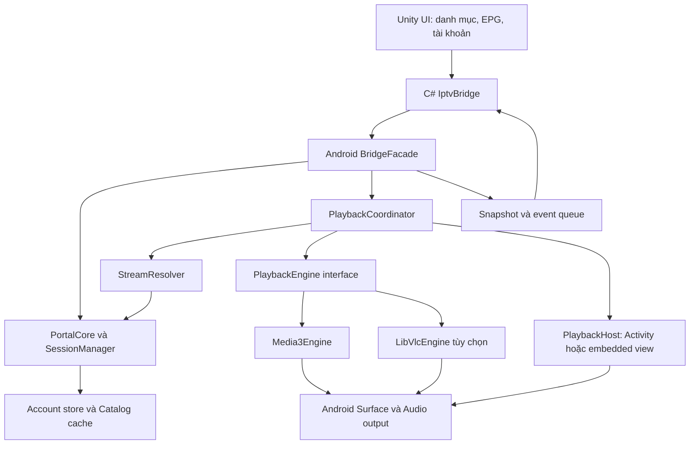
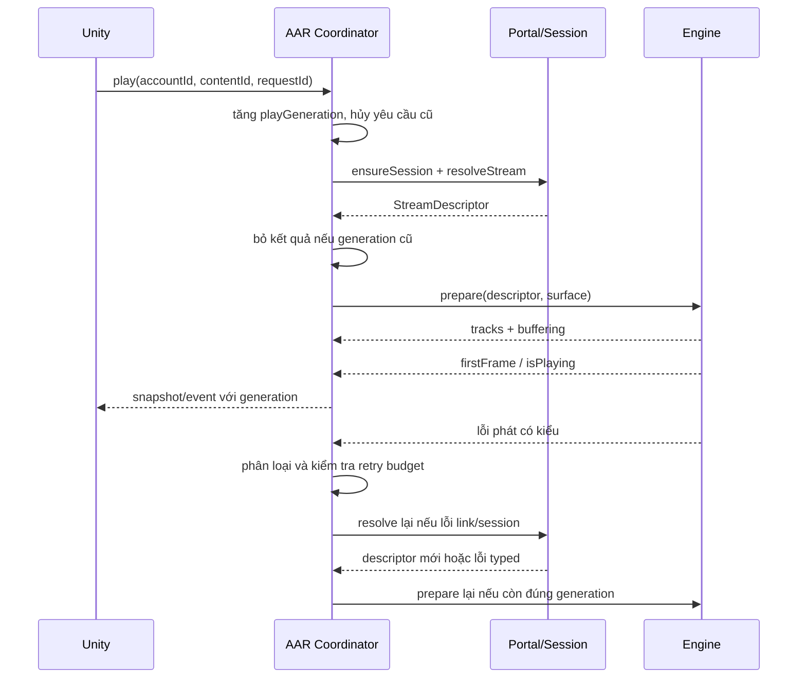

# Mẫu thiết kế streaming IPTV: Unity + Android AAR

Ngày: 03/10/2026. Trạng thái: đặc tả thiết kế và hợp đồng API; chưa phải AAR hoặc Unity project đã build.

## 1. Kết luận và giả định

**Unity phụ trách giao diện danh mục/EPG và thao tác người dùng; Android AAR sở hữu portal, session, resolve link, player và phục hồi lỗi. Video được giải mã và xuất ra Android Surface, không chuyển từng frame qua C#.**

“Native” trong mẫu này nghĩa là Kotlin/Java chạy phía Android, dùng Android media API. C/C++/JNI chỉ cần khi tích hợp engine như LibVLC/libmpv hoặc cầu nối texture vào Unity. Portal HTTP không cần viết C++ để đạt mục tiêu này.

Bản đầu nhắm Android/Android TV, một stream phát chính, Live/VOD/catch-up; dùng Kotlin AAR và Unity C# với IL2CPP. Phiên bản Unity, minSdk, targetSdk, đồ họa GLES/Vulkan và dải thiết bị chưa được cung cấp: phải chốt bằng compatibility matrix trước khi build release, không coi các ví dụ là một bộ dependency đã kiểm chứng.

Mẫu kế thừa [thiết kế connect/reload portal](ANDROID_PORTAL_CONNECT_RELOAD_DESIGN.vi.md), đặc biệt single-flight refresh, session version và account generation.

## 2. SFVIP thực sự phát video bằng gì?

Trong mã khôi phục, `_player` có kiểu `IMpvPlayer`; app tạo `new MpvPlayer`, nạp cấu hình/scripts, gắn player vào `Videoview`, rồi gọi `_player.Load(...)` và `_player.Resume()`. Bộ cài có `libmpv.dll` và `lib/mpv-1.dll`.

Nguồn local: [C# khôi phục](../.analysis/decompiled/sfvip%20player.decompiled.cs), dòng 38193, 39294–39314 và 40694–40700.

Do đó .NET là lớp điều phối/giao diện, engine mpv bên dưới xử lý media. Không thể suy ra rằng chuyển .NET sang Unity sẽ tự mang theo toàn bộ codec. Android cần engine và decoder dành cho Android; DLL Windows không dùng lại trực tiếp. Chưa xác định build flags hoặc danh sách decoder chính xác của binary mpv đi kèm. Tham khảo [tài liệu mpv](https://mpv.io/manual/stable/) cho cấu hình engine.

## 3. Lựa chọn engine

| Engine | Vai trò trong mẫu | Điều cần chấp nhận |
|---|---|---|
| Media3 ExoPlayer | Engine mặc định cho HLS/DASH/HTTP progressive; tích hợp Android playback và DRM nếu cần | Codec phụ thuộc decoder thiết bị; hỗ trợ container không bảo đảm giải mã mọi video bên trong |
| LibVLC Android | Engine tùy chọn cho tập stream mà Media3 không đáp ứng, được xác nhận bằng fixture | Thêm native binary, kích thước, bộ nhớ và kiểm thử; software decode có thể chậm |
| libmpv Android | Phương án thay engine khi ưu tiên hành vi gần SFVIP | Cần tích hợp/build Android riêng, JNI, render/audio/lifecycle và duy trì cấu hình; không mặc định tương thích với binary Windows |

**Chọn cho MVP: Media3 + interface `PlaybackEngine`; build biến thể Compatibility có LibVLC khi bộ stream kiểm thử chứng minh cần.** Nếu ngay từ đầu tập kênh chủ yếu là định dạng không tương thích Media3, có thể chọn LibVLC làm engine chính qua cùng interface, không thay portal core.

Media3 phân biệt giao thức streaming, container và codec; decoder mặc định đến từ Android. LibVLC là engine dùng trong VLC Android. Nguồn: [Media3 supported formats](https://developer.android.com/media/media3/exoplayer/supported-formats), [VideoLAN Android](https://github.com/videolan/vlc-android).

Không chạy hai engine phát cùng lúc. Khi chuyển engine: ghi lại trạng thái cần giữ → detach surface → stop/release engine cũ → tạo engine mới → attach surface → prepare. Chỉ chuyển tối đa một lần cho mỗi yêu cầu phát; không ping-pong giữa hai engine.

## 4. Kiến trúc



| Module | Sở hữu |
|---|---|
| `portal-core` | Account, adapters MAG/Xtream/playlist, HTTP, auth, session, catalog |
| `stream-core` | Resolve link, playback state, recovery budget, engine selection |
| `player-media3` | MediaSource, decoder/track selection, load control, player callbacks |
| `player-libvlc` | Adapter engine tùy chọn, normalize state/error/track |
| `android-host` | Surface, controls, D-pad, lifecycle, audio focus |
| `unity-bridge` | API có version, request ID, event delivery và snapshot |
| Unity `IptvClient` | UI và state projection; không sở hữu token hay thuật toán refresh |

Mỗi app process có một runtime AAR; mỗi tài khoản có session context riêng. MVP chỉ có một `PlaybackCoordinator` đang hoạt động. Không giữ static reference đến Unity Activity đã bị destroy; host attach/detach theo vòng đời.

## 5. Hiển thị video với Unity

### Phương án mặc định: PlaybackActivity native

Unity hiển thị catalog; khi chọn kênh, AAR mở `PlaybackActivity` chứa video Surface và controls native. Back trở về Unity. App cuối cùng vẫn được build và đóng gói bởi Unity.

Ưu điểm của quyết định này là không phải giải quyết ngay việc Unity Surface và video Surface chồng lên nhau. Player tiếp tục hoạt động khi Unity Activity bị pause do mở PlaybackActivity; không được dùng mọi `OnApplicationPause(true)` của Unity như lệnh stop player.

Controls trên màn hình phát gồm play/pause, next/previous, audio/subtitle, aspect ratio, EPG gọn và Back. Chúng gọi cùng coordinator như lệnh từ Unity; không có state riêng cạnh tranh.

### Nếu bắt buộc giữ UI Unity trên màn hình phát

| Chế độ | Thiết kế | Giới hạn |
|---|---|---|
| Native view theo vùng chữ nhật | Gắn player view vào host Activity; bridge gửi vùng hiển thị theo pixel sau khi quy đổi từ Unity layout | Cần kiểm thử z-order, touch, D-pad, orientation, insets; không giả định Canvas Unity vẽ được trên SurfaceView |
| Video thành texture Unity | SurfaceTexture/external GPU texture qua native rendering plugin | Phải làm riêng cho graphics backend, đồng bộ render thread, texture lifetime và màu; không phải tính năng có sẵn chỉ bằng AAR |

Ưu tiên SurfaceView cho player native khi phù hợp. Android ghi nhận lợi ích về điện năng, timing và một số trường hợp HDR/secure output so với TextureView; cần kiểm tra theo thiết bị. Nguồn: [Android surface types](https://developer.android.com/media/media3/ui/surface).

Không dùng JNI/JSON để chuyển bitmap từng frame. Chế độ texture không mặc định hỗ trợ secure DRM hoặc giữ nguyên HDR; nếu nội dung cần secure output, chọn đường render được engine/thiết bị hỗ trợ thay vì ép texture Unity.

## 6. Hợp đồng dữ liệu stream

Unity gửi **content ID**, không tự ghép URL phát hoặc sửa cookie. Native resolve thành descriptor dùng nội bộ:

```kotlin
// Pseudocode hợp đồng; không phải mã đã compile.
data class PlaybackRequest(
    val requestId: String,
    val accountId: String,
    val contentId: String,
    val kind: ContentKind,       // LIVE, VOD, CATCH_UP
    val startPositionMs: Long?, // VOD; Live mặc định theo live edge
    val catchupStartUtcMs: Long?,
    val catchupEndUtcMs: Long?
)

data class StreamDescriptor(
    val uri: String,
    val mimeTypeHint: String?,
    val transport: Transport,
    val requestPolicyId: String, // native-only headers/cookies/host policy
    val expiresAtUtcMs: Long?,
    val seekableHint: Boolean?,
    val drmConfigId: String?,
    val generation: Long
)
```

`requestPolicyId` tham chiếu policy cho manifest, segment, encryption key, subtitle và redirect. Áp dụng header/cookie theo origin được cho phép; không gửi portal Authorization sang mọi CDN. Cookie mới từ response phải được ghi về đúng context. Mỗi media item có policy bất biến; đổi kênh không sửa global header map của request cũ.

STB user-agent của portal có thể khác player user-agent; giữ cấu hình riêng như SFVIP. Stream URL có thể không có phần mở rộng, nên MIME hint lấy từ contract/response đã xác minh, không chỉ từ đuôi URL. `cmd` do portal trả là dữ liệu để adapter trích URL, không thực thi như shell command.

MVP hỗ trợ các transport đã có fixture: HLS, DASH và HTTP progressive/TS. RTSP, UDP multicast và giao thức khác là capability riêng theo engine, không suy ra từ hỗ trợ HEVC. Ví dụ tài liệu Media3 hiện liệt kê RTSP codec/network hạn chế hơn HTTP. Nguồn: [supported formats](https://developer.android.com/media/media3/exoplayer/supported-formats).

## 7. Luồng chọn kênh và phát



Native host có thể gọi `next/previous` trực tiếp khi Unity đang pause. Thứ tự kênh thuộc playlist context đã truyền cho native, không phụ thuộc callback Unity phải chạy để tiếp tục phát.

```text
Idle → Resolving → Preparing → Buffering → Playing
Playing ↔ Paused
Playing → Buffering → Playing
Resolving/Preparing/Buffering/Playing → Recovering → Preparing
Any active → Stopped hoặc Error
VOD Playing → Ended
```

`Ready` của engine không đồng nghĩa người dùng đã thấy frame. Tách `prepared`, `firstFrame`, `isPlaying`, `buffering` và `playWhenReady` trong snapshot. Audio-only có tiêu chí bắt đầu riêng. `stop` khác `release`: stop kết thúc item; release giải phóng decoder/engine.

## 8. HEVC và các codec

HEVC/H.265 là codec, MKV/MP4/TS là container, HLS/DASH là cơ chế phân phối. Cả đường demux, video decode, audio decode và render phải hoạt động mới xem được kênh.

| Nội dung | Policy đề xuất |
|---|---|
| H.264 + AAC phổ biến | Media3/hardware trước, fixture theo container |
| HEVC Main 8-bit | Kiểm tra decoder cho format thật, resolution và frame rate; thử hardware |
| HEVC Main10 10-bit | Kiểm tra profile và decoder; không coi hỗ trợ HEVC 8-bit là đủ |
| HEVC HDR | Kiểm tra profile, color transfer, display và render path; hỗ trợ decode chưa đủ để khẳng định HDR đúng |
| HEVC 4K/50–60 fps | Chỉ cam kết trên thiết bị đã test tải dài; kiểm tra dropped frames và thermal |
| AC-3/E-AC-3/DTS/MP2 | Kiểm tra audio decoder/output; có hình không tiếng là lỗi audio riêng |
| Codec/container không hỗ trợ | Chuyển compatibility engine một lần nếu có capability và nội dung cho phép |
| DRM | Engine selection dựa trên DRM capability; không fallback sang software engine để bỏ DRM |

CapabilityService dùng codec list/capabilities và format track sau khi parse. Khi chưa biết codec, trả `Unknown`, không `Supported`. Có decoder được quảng cáo chỉ là tín hiệu trước khi thử: vẫn phải xử lý initialization failure, decoder crash và output không đủ tốc độ.

Ladder fallback: decoder thích hợp trong engine → rendition nhẹ hơn/codec khác nếu nguồn cung cấp → compatibility engine nếu đã đóng gói và cho phép → báo không hỗ trợ. Giới hạn một lần đổi engine và một lần giảm rendition mỗi yêu cầu phát. Không giả định giảm chất lượng được đối với stream TS một bitrate.

**FFmpeg extension của Media3 là thư viện giải mã audio; thêm nó không tự cung cấp HEVC video software decoder.** Muốn software HEVC phải chọn engine/build có decoder đó và benchmark CPU. Nguồn: [Media3 FFmpeg extension](https://github.com/androidx/media/blob/release/libraries/decoder_ffmpeg/README.md).

Nếu thiết bị không giải mã nổi, giải pháp sản phẩm là cung cấp rendition phù hợp hoặc transcoding phía server do hệ thống kiểm soát. AAR không thể bảo đảm phát HEVC 4K mượt trên mọi Android box.

## 9. Kết hợp lỗi portal và lỗi player

| Lỗi | Recovery | Không làm |
|---|---|---|
| Missing/expired portal session | Single-flight handshake + profile, replay resolve một lần | Refresh trên từng segment |
| Auth bị từ chối / account khóa | Dừng và trả NeedsAction | Retry vô hạn hoặc đổi device identity |
| Link stream hết hạn / CDN 401,403 | Resolve URL mới một lần; chỉ refresh portal nếu API portal xác nhận session lỗi | Coi mọi CDN 403 là sai tài khoản |
| HTTP timeout/5xx | Engine retry ngắn; hết budget thì coordinator quyết định retry/re-resolve | Để engine và coordinator tự retry song song |
| Live đứng hình do transport | Kiểm tra tiến triển frame/position và buffer; reconnect có giới hạn | Dùng một timer cố định kết luận mọi buffering là lỗi auth |
| Decoder init/unsupported codec | Thử decoder/rendition/engine theo capability | Reload session vì codec lỗi |
| Parser/container lỗi | Compatibility engine một lần nếu có | Lặp lại handshake không liên quan |
| Surface mất | Detach, đợi host/surface mới; resume theo policy | Tạo engine mới cho mỗi frame hoặc mất view tạm |
| Audio route/focus thay đổi | Pause/duck/resume theo policy; cập nhật route | Cho Unity và native cùng giữ hai audio focus owner |
| VOD kết thúc | Ended bình thường | Tự reconnect như mất mạng |
| Live EOF bất ngờ | Retry có giới hạn theo loại nguồn | Đồng nhất với VOD Ended |
| Đổi kênh/Back/logout | Hủy generation, bỏ callback cũ | Phát lại kênh đã bị thay thế |

Ngân sách mẫu để hiệu chỉnh bằng đo đạc: 1 auth recovery, 1 re-resolve link, 1 engine switch; transport retry 2 lần với backoff và tổng startup/recovery deadline 30 giây. Không nhân tất cả budget qua các tầng; coordinator giữ ledger chung theo `playGeneration`, tính cả số lần engine đã thử. Khi đã phát ổn định, một incident mới có ledger mới, nhưng giới hạn tổng reconnect trong cửa sổ thời gian để tránh loop dài.

VOD/catch-up lưu position khi đổi engine, chỉ seek lại khi nguồn mới cho phép. Live reconnect theo live edge mục tiêu; không seek timestamp cũ đã ra khỏi live window.

## 10. Bridge Unity ↔ AAR

Bridge bất đồng bộ. Lệnh submit trả ACK nhanh; hoàn tất đi qua event. Đồng bộ chỉ dùng cho snapshot nhỏ đã có sẵn, không chờ network hoặc player prepare trên Unity main thread.

| API | Mục đích |
|---|---|
| `initialize(config, listener)` | Tạo runtime, thống nhất bridgeVersion |
| `submit(commandJson)` | Connect, play, pause, resume, seek, stop, refreshSession, reloadCatalog |
| `getSnapshot()` | State mới nhất khi Unity resume hoặc mất event |
| `getCatalogPage(query)` | Phân trang danh mục, không truyền toàn bộ hàng chục nghìn kênh mỗi frame |
| `selectTrack(trackKey)` | Chọn audio/subtitle từ track list hiện tại |
| `openPlaybackHost(playbackId)` | Mở host native cho playback đã tạo |
| `cancel(requestId)` | Hủy request cụ thể; không hủy shared auth refresh của caller khác |
| `shutdown()` | Hủy scope, release engine, listener và surface |

```json
{
  "bridgeVersion": 1,
  "requestId": "play-104",
  "command": "play",
  "accountId": "account-7",
  "contentId": "channel-203",
  "kind": "LIVE"
}
```

```json
{
  "bridgeVersion": 1,
  "eventSeq": 318,
  "requestId": "play-104",
  "playbackId": "p-104",
  "generation": 12,
  "type": "PlaybackStateChanged",
  "payload": { "state": "PLAYING", "engine": "MEDIA3", "firstFrame": true }
}
```

Event lỗi có `domain` (PORTAL/STREAM/DECODER/RENDER/BRIDGE), `code`, `retryable`, `stage` và thông báo an toàn. Không gửi token, cookie, signed URL hoặc raw body về Unity/log. Track key chỉ có hiệu lực trong generation hiện hành.

Có thể gọi Java/Kotlin bằng `AndroidJavaObject`, callback bằng `AndroidJavaProxy` hoặc `UnitySendMessage`. Chọn một đường callback cho implementation, không phát trùng trên cả hai. Nguồn: [Unity gọi C# từ Java/Kotlin](https://docs.unity.com/en-us/engine/6000.6/manual/platform-specific/android/developing/plugins-for/plugins-csharp-code-from-java-kotlin).

Quy tắc thread:

- Bridge nhận lệnh trên thread bất kỳ, marshal thao tác player/view sang Android main thread. Network/JSON/database chạy trên dispatcher riêng.
- Với Media3 + native UI, truy cập player trên application/main thread theo [threading của ExoPlayer](https://developer.android.com/media/media3/exoplayer/hello-world).
- Callback C# chỉ đưa DTO vào queue; Unity xử lý GameObject/UI trong `Update()` trên Unity main thread. Không giả định Android UI thread là Unity main thread.
- AAR lưu snapshot authoritative. Khi Unity pause, gộp progress event, giữ queue hữu hạn và event sequence; khi resume lấy snapshot trước. Không bắt buộc phát lại mọi progress event đã bỏ.
- Event lỗi/completion được lưu theo request đến khi ACK hoặc TTL; snapshot kèm last terminal error để UI phục hồi. Listener detach không phá runtime playback còn có host sở hữu.

## 11. Lifecycle, bộ đệm và hiệu năng

MVP dùng foreground playback: PlaybackActivity sở hữu playback đang hiển thị; rời app thì pause theo policy, Back kết thúc playback và trở về Unity. Activity recreate lưu playback ID, position và lựa chọn track; surface mới attach vào session còn sống hoặc prepare lại nếu process đã chết. Không giữ Surface/Activity cũ.

Nếu cần background audio/PiP, mở rộng ownership bằng service/media session và policy hệ điều hành tương ứng; không giữ process bằng vòng lặp Unity. Thiết kế MVP không tự hứa background playback.

Các thông số dưới đây là điểm bắt đầu thử nghiệm, không phải mặc định thư viện:

| Hạng mục | Giá trị/mục tiêu ban đầu |
|---|---|
| Live buffer | Min 3–5 giây, max 10–15 giây; kiểm tra lại với latency manifest |
| VOD buffer | Khoảng 10–30 giây, kèm byte cap theo memory class |
| Live edge | Theo manifest/engine; không ép low latency với nguồn HLS segment dài |
| Progress qua bridge | 2–4 lần/giây khi UI cần; không gửi mỗi video frame |
| Số decoder | Một video decoder chính; chưa preload kênh kế tiếp ở MVP |
| Disk cache | Tùy chọn cho VOD; Live mặc định không ghi liên tục vào disk |
| Cache key | Nội dung/account/rendition ổn định; không dùng signed URL thô để trộn quyền hoặc cache sai |

Audio chỉ đi qua engine native; Unity tắt/giảm âm thanh UI theo chính sách audio focus. Giữ màn hình sáng khi thực sự phát. Android TV cần kiểm thử remote D-pad, focus và nút Back trong host native.

Quan sát: thời gian resolve, thời gian đến frame đầu, rebuffer count/duration, decoder name, hardware/software nếu xác định được, dropped frames, resolution, FPS, bitrate, audio codec, engine switch, session recovery và memory. Metrics phải gắn playback generation và không chứa credential.

## 12. Đóng gói AAR và build Unity

```text
android-iptv-sdk/
  portal-core/
  stream-core/
  player-media3/
  player-libvlc/       # chỉ biến thể Compatibility
  android-host/
  unity-bridge/       # public Java-friendly facade
  sample-android/     # host test độc lập với Unity
unity-project/
  Assets/Iptv/Runtime/IptvClient.cs
  Assets/Iptv/Runtime/BridgeDtos.cs
  Assets/Iptv/Runtime/MainThreadEventQueue.cs
  Assets/Plugins/Android/   # AAR hoặc cấu hình dependency resolver
```

Unity hỗ trợ Android Library/AAR plugin, gồm code/resources/manifest. Nguồn: [Unity AAR plugins](https://docs.unity.com/en-us/engine/6000.3/manual/platform-specific/android/developing/plugins-for/plugin-types/aarplugins).

**AAR thông thường không tự nhúng toàn bộ transitive dependencies.** Phương án phân phối ưu tiên: Maven artifact có POM/module metadata, Unity Gradle khai báo dependency; hoặc đưa AAR local và khai báo đầy đủ dependencies kèm theo. Các module Android nội bộ cũng cần được publish/resolve, không chỉ copy `unity-bridge.aar` rồi coi đã đủ.

Các dependency nhóm Media3 dự kiến: exoplayer, exoplayer-hls, exoplayer-dash, ui; thêm datasource integration nếu chọn HTTP client riêng, session khi cần system controls. Pin cùng version Media3 và kiểm tra với Unity Gradle/AGP/JDK đang dùng, không dùng version `+`. [Hướng dẫn Media3](https://developer.android.com/media/media3/exoplayer/hello-world) yêu cầu đồng bộ version giữa các module.

Release gate:

- Chốt Unity editor, IL2CPP, Gradle/AGP/JDK, Android SDK/NDK và dependency lockfile trong CI.
- Bridge API public Java-friendly; consumer R8 rules giữ facade/callback/DTO cần reflection. Phía Unity giữ callback khỏi stripping; kiểm thử IL2CPP release, không chỉ Mono/editor.
- Không đóng gói duplicate Unity runtime classes trong AAR; nếu cần Unity Java classes để compile thì dùng compile-only dependency đúng phiên bản.
- Manifest merge gồm Internet, PlaybackActivity và thành phần thật sự sử dụng. PlaybackActivity nội bộ không exported; HTTP cleartext legacy chỉ cấu hình theo yêu cầu portal cụ thể.
- Nếu có `.so`, kiểm tra ABI được chọn, thiếu symbols, xung đột `libc++_shared.so` và các thư viện cùng tên. Không dùng `pickFirst` để che xung đột binary chưa xác minh.
- Kiểm tra hỗ trợ page size trên **toàn bộ APK/AAB**, bao gồm Unity và engine native; tham khảo [Android 16 KB page sizes](https://developer.android.com/guide/practices/page-sizes).
- Lưu manifest dependency, phiên bản engine và cấu hình codec/build để truy vết khả năng phát; kiểm tra các yêu cầu phân phối của dependency đã chọn trước phát hành.

Không đặt con số minSdk hoặc phiên bản engine cố định trong tài liệu khi chưa biết Unity và phần cứng đích. Bước triển khai phải chọn bộ version cụ thể và chứng minh bằng sample Android cùng Unity release build.

## 13. Ma trận nghiệm thu

| Nhóm | Ca bắt buộc |
|---|---|
| Codec | H.264; HEVC Main/Main10; 1080p/4K; 25/30/50/60 fps; thiết bị thiếu decoder |
| Container/transport | HLS TS, HLS fMP4, DASH, HTTP TS, MP4/MKV trong phạm vi cam kết; URL không đuôi |
| Audio | AAC, MP2, AC-3/E-AC-3/DTS theo tập nguồn; stereo và HDMI/Bluetooth route |
| Màu/render | SDR, HDR theo thiết bị; aspect ratio, rotation, subtitle; secure output nếu có DRM |
| Auth | Token thiếu/hết hạn, refresh đồng thời, account bị khóa, CDN 403, URL hết hạn |
| Recovery | Timeout, 5xx, mất mạng, Live EOF, stuck buffer; không vượt ledger |
| Đổi kênh | 20 thao tác chọn nhanh; chỉ kênh cuối phát; không nghe hai audio stream |
| Lifecycle | Unity pause khi mở host, Back, Home/resume, Activity recreate, process death |
| Race | Callback cũ sau switch account/stop/engine fallback không đổi state mới |
| Hiệu năng | Phiên phát dài 30–60 phút, memory plateau, dropped frames, nhiệt/CPU và AV sync |
| Bridge | Listener mất, queue đầy, resume snapshot, event sequence, DTO version không tương thích |
| Release | IL2CPP + R8 + stripping, ABI thật, APK/AAB cài trên điện thoại và Android TV |

Ghi kết quả theo thiết bị/SoC/Android/engine/build/codec profile; không đánh dấu “HEVC supported” chỉ sau một file mẫu. Các ca kiểm thử trong tài liệu này chưa được thực thi.

## 14. Các mốc triển khai

1. **Chứng minh player:** sample Android phát tập stream đại diện bằng Media3 trên thiết bị đích; ghi decoder và lỗi. Quyết định có cần Compatibility engine.
2. **Portal native:** tái dùng đặc tả connect/reload, xây adapter và StreamDescriptor có host policy; test bằng fake server.
3. **AAR facade:** command/event/snapshot, generation, cancellation, typed errors; sample Android chạy hoàn chỉnh.
4. **Unity integration:** Unity catalog → native PlaybackActivity → Back; IL2CPP release và lifecycle test.
5. **Recovery và tuning:** ledger, link refresh, engine switch nếu cần, tracks/subtitles/audio focus, buffer tuning.
6. **Embedded video tùy yêu cầu UI:** chỉ làm sau khi chốt native view hay texture, GLES/Vulkan, HDR/DRM và thiết bị đích.

Đầu ra MVP mong muốn: SDK AAR cùng dependency metadata, Unity C# wrapper, native sample host, Unity sample scene, fixture/test matrix và tài liệu version đã kiểm chứng. Workspace hiện tại mới tạo đặc tả này; chưa có SDK build được.
