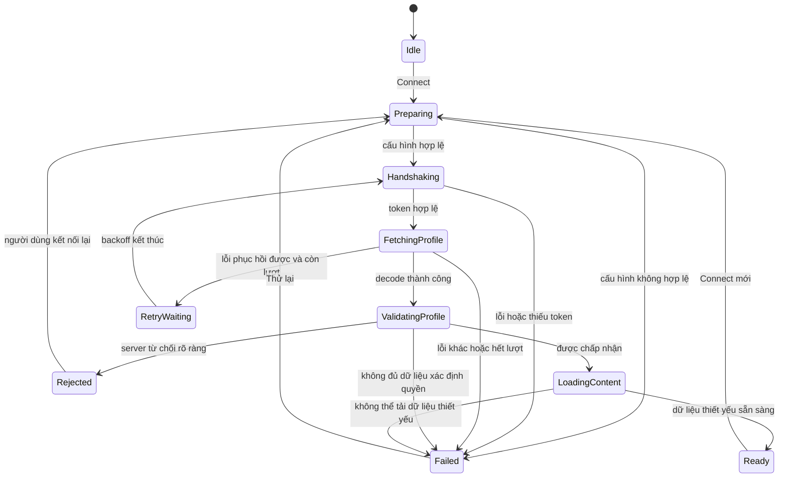

> **Lưu ý (2026-10-12):** Stalker portal/WebView đã được thay bằng Xtream Codes API — xem `Docs/superpowers/specs/2026-10-12-xtream-live-design.vi.md`. Tài liệu này chỉ còn giá trị lịch sử.

# Đặc tả triển khai luồng Connect, Profile Reject và Force Login

- Dự án đích: StbEmu của bạn.
- Ngày: 03/10/2026.
- Trạng thái: đặc tả triển khai đề xuất, chưa tích hợp vào mã nguồn dự án.
- Nguồn tham khảo: phân tích tĩnh StbEmuTV 4.4.2, build 20918.1.
- Phạm vi: chọn portal → handshake → profile → tải dữ liệu; retry, cancel, cache và trạng thái UI.

## 1. Mục tiêu và nguyên tắc

Triển khai một luồng kết nối có điểm kết thúc rõ ràng, không treo loading, không retry vô hạn và không coi việc parse JSON thành công là bằng chứng tài khoản được phép truy cập.

Force Login chỉ điều khiển việc làm mới cache nội dung của portal. Dù bật hay tắt, ứng dụng vẫn thực hiện handshake và lấy profile. Force Login không bỏ qua xác thực và không tự thêm tham số force=1 vào request.

Tài liệu dùng thiết kế đề xuất tại các phần 3–12 làm chuẩn triển khai. Các cải thiện so với IPA được chỉ rõ ở phần 2. Không cần tạo hai chế độ hành vi trong sản phẩm.

## 2. Hành vi IPA và quyết định cho dự án

| Nội dung | Đã quan sát từ IPA | Quyết định triển khai đề xuất |
|---|---|---|
| Force Login | Khóa forceLoginPortal, mặc định bật; bật xóa dữ liệu theo ID portal | Giữ ý nghĩa và mặc định; chỉ vô hiệu hóa cache nội dung thuộc portal |
| Handshake/get_profile | Luôn thực hiện; không thuộc whitelist cache nội dung | Giữ nguyên |
| Profile request/decode lỗi | Chạy lại từ handshake thêm tối đa 3 lần | Giữ ngân sách tối đa 3 retry; chỉ retry lỗi có khả năng phục hồi |
| Handshake lỗi | Hiện lỗi và dừng trong callback đã kiểm tra | Dừng; cho phép người dùng Thử lại |
| Handshake thiếu token | Return sớm, chưa thấy đóng loading trong nhánh đó | Chuyển Failed với InvalidHandshake, đóng loading |
| Profile decode được nhưng bị chặn | Chưa thấy callback connect chặn theo blocked/block_msg | Kiểm tra quyền truy cập riêng, chặn khi có bằng chứng reject rõ ràng |
| Profile thiếu id | Decoder cho phép nil | Xem là InvalidProfile nếu adapter portal yêu cầu id; không kết luận bị khóa |
| Retry và đổi portal | Chưa xác minh đầy đủ cơ chế chống callback cũ | Bắt buộc dùng operationId và snapshot portal |

Giới hạn nguồn: kết quả IPA là phân tích tĩnh, chưa kiểm chứng runtime. Cách diễn giải HTTP status, js:false/js:null, blocked và thời hạn phải được đối chiếu với portal thực tế. Các quy tắc bên dưới là hợp đồng của dự án đề xuất, không phải khẳng định mọi portal đều tuân theo.

## 3. Các thành phần

| Thành phần | Trách nhiệm |
|---|---|
| ConnectionCoordinator | Sở hữu state, operationId, ngân sách retry, cancel; điều phối toàn bộ connect |
| PortalAdapter | Chuẩn hóa endpoint, dựng request, giải mã envelope và diễn giải quyền truy cập theo loại portal |
| PortalApiClient | Gửi request, áp dụng timeout, trả HTTP status/body/error; không tự retry ngầm |
| SessionStore | Giữ token, random, profile và playToken của phiên đã được chấp nhận |
| PortalContentCache | Cache danh mục/kênh theo portal, tài khoản và thế hệ cache |
| ContentLoader | Tải dữ liệu thiết yếu, dùng cache hợp lệ khi được phép |
| ConnectionViewModel | Chuyển state thành nội dung UI và hành động người dùng |

Không đặt logic retry riêng ở cả HTTP client, adapter và coordinator. Coordinator là nơi duy nhất quyết định retry chuỗi connect.

## 4. Mô hình dữ liệu

```text
PortalSnapshot {
    id
    endpoint
    accountIdentity           // MAC/tài khoản và cấu hình nhận dạng đã chọn
    deviceConfiguration      // serial, device IDs, model... nếu portal cần
    adapterType
    configurationFingerprint // thay đổi khi thông tin ảnh hưởng request thay đổi
}

ConnectOptions {
    forceLogin: Boolean = true
    maxProfileRetries: Integer = 3
    requestTimeoutSeconds: Integer = 20
    operationTimeoutSeconds: Integer = 180
    retryDelaysSeconds: List = [1, 2, 4]
}

ConnectionContext {
    operationId
    portal: PortalSnapshot   // bất biến trong suốt operation
    options: ConnectOptions  // snapshot khi bắt đầu
    profileRetryCount = 0
    cancellationToken
    deadline
    cacheGeneration
}

PendingSession {
    handshakeToken
    random?
    profile?
    playToken?
}

ProfileAccess = Accepted | Rejected(reason, safeMessage) | Unknown(reason)
```

Các thời gian timeout và backoff là giá trị khởi đầu đề xuất, không lấy từ IPA. Mọi request dùng timeout nhỏ hơn giữa requestTimeout và thời gian còn lại của operation.

`handshakeToken` và `playToken` là hai giá trị khác nhau; không dùng thay thế tùy tiện. Mật khẩu parental được quản lý riêng, không phải mật khẩu xác thực portal. Không tự áp dụng fallback "0000" của IPA vào chính sách parental của dự án khi chưa có yêu cầu sản phẩm.

## 5. Máy trạng thái



Từ mọi trạng thái đang xử lý có thể chuyển sang Cancelled. Khi đổi portal hoặc Connect lại, hủy operation cũ và tạo operation mới. Hết deadline chuyển Failed với OperationTimeout. `Ready`, `Failed`, `Rejected`, `Cancelled` đều phải tắt loading và kết thúc operation đúng một lần.

`Rejected` dùng cho từ chối quyền truy cập đã xác định; `Failed` dùng cho lỗi mạng, phản hồi hoặc cấu hình. Không gộp chúng thành thông báo “sai MAC”.

## 6. Trình tự kết nối

### 6.1. Entry — bắt đầu bởi người dùng hoặc auto-connect

1. Hủy operation đang chạy; vô hiệu hóa phiên active cũ để UI không tiếp tục phát bằng phiên cũ trong khi đổi portal.
2. Tạo operationId mới và snapshot portal/options. Không đọc lại portal đang chọn giữa các lần retry.
3. Kiểm tra endpoint, cấu hình nhận dạng và adapter. Không có cấu hình hợp lệ thì Failed ngay.
4. Đặt profileRetryCount = 0; reset danh sách đang hiển thị và lỗi cũ.
5. Nếu Force Login bật: tăng thế hệ cache để dữ liệu cũ không còn được đọc; xóa cache nội dung của đúng portal khi có thể.
6. Nếu xóa vật lý thất bại: vẫn tiếp tục tải mới bằng thế hệ cache mới, ghi diagnostic; không quay lại dùng cache cũ trong operation này.
7. Chạy attempt từ handshake.

Việc reset retry và vô hiệu hóa cache chỉ xảy ra một lần ở entry, không lặp lại trong retry nội bộ.

### 6.2. Handshake

- Adapter dựng request handshake từ cấu hình portal.
- Điểm tham khảo từ IPA: `type=stb&action=handshake&token=`, bổ sung `prehash` và `JsHttpRequest=1-xml`.
- Chỉ gửi các tham số đúng hợp đồng portal. Không sao chép chuỗi prehash cố định của ứng dụng tham khảo như một giá trị bắt buộc cho mọi portal.
- Không sử dụng token hoặc random của attempt thất bại trước; adapter phải quy định rõ nếu một loại portal yêu cầu token đầu vào khác rỗng.
- Kiểm tra HTTP và envelope rồi lấy token. Token thiếu, null hoặc chỉ có khoảng trắng → InvalidHandshake.
- Token/random mới chỉ được lưu trong PendingSession của operation hiện tại.
- Handshake lỗi → Failed, không tự dùng ngân sách retry profile.

### 6.3. Lấy profile

Request tham khảo từ IPA:

```text
type=stb
hd=1
not_valid_token=0
video_out=hdmi
action=get_profile
num_banks=2
auth_second_step=1
```

Adapter nối các tham số nhận dạng và thiết bị cần thiết, prehash, JsHttpRequest; encode query bằng thư viện URL thay vì ghép chuỗi thô. Dùng token vừa lấy cho Authorization Bearer nếu portal yêu cầu; Cookie theo cấu hình portal.

Giữ riêng raw response đã che thông tin nhạy cảm cho chẩn đoán và model đã chuẩn hóa cho nghiệp vụ. Không cache token hoặc profile trong cache danh mục/kênh.

### 6.4. Kiểm tra profile và quyền truy cập

Thứ tự kiểm tra:

1. Nếu adapter xác định explicit deny/account disabled/blocked: Rejected ngay, kể cả profile thiếu id.
2. Nếu response không có đối tượng profile dùng được: InvalidProfile/InvalidResponse, không tự tạo profile rỗng rồi coi là thành công.
3. Chuẩn hóa id String hoặc Integer. Yêu cầu id không rỗng nếu hợp đồng adapter cần nó; không suy diễn id=0 luôn là reject cho mọi portal.
4. Diễn giải blocked bằng mapping đã biết của adapter; ví dụ adapter có thể hỗ trợ `1`, `"1"`, `true`. Không ép mọi giá trị không rỗng thành true.
5. `block_msg` và `msg` là nội dung hỗ trợ hiển thị, không phải bằng chứng reject độc lập khi chưa biết hợp đồng portal.
6. Chỉ kiểm tra hết hạn khi đã biết chính xác field, định dạng và múi giờ; ngày thiếu hoặc không parse được không được tự coi là hết hạn.
7. Nếu đủ dữ liệu xác nhận hợp lệ: Accepted. Nếu quyền truy cập chưa xác định: Unknown → Failed với thông báo phản hồi chưa được hỗ trợ; không đi Ready.

Khi Rejected: hủy tác vụ tiếp nối, bỏ PendingSession, xóa token/playToken active của operation và không hiển thị nội dung cache như một phiên đã đăng nhập. Giữ cấu hình portal để người dùng chỉnh sửa.

### 6.5. Tải nội dung và hoàn tất

- Sau Accepted, giữ phiên hợp lệ cho ContentLoader trong phạm vi operation; chưa công bố Ready.
- Nếu Force Login tắt, có thể dùng cache danh mục/kênh hợp lệ cùng portal và configurationFingerprint.
- Nếu Force Login bật, tải mới và ghi vào thế hệ cache hiện hành.
- Tải dữ liệu cần cho màn hình khởi đầu, ví dụ nhóm TV và danh sách kênh; VOD/series có thể tải khi mở tab.
- Danh sách rỗng hợp lệ được phép Ready với empty-state “Không có kênh”. Phải phân biệt với response lỗi.
- Account info/watchdog được triển khai theo adapter. Lỗi dữ liệu phụ thông thường không khóa toàn bộ UI; phản hồi xác nhận thu hồi quyền truy cập phải kết thúc phiên.
- Khi dữ liệu thiết yếu sẵn sàng và operation còn hiệu lực: commit SessionStore và chuyển Ready.
- Lỗi tải nội dung không tự kích hoạt vòng retry profile. Trả Failed, cho phép thử lại theo hành động rõ ràng.

## 7. Phân loại lỗi và retry

| Sự kiện | Phân loại đề xuất | Tự retry chuỗi connect? |
|---|---|---|
| URL/cấu hình không hợp lệ | InvalidConfiguration | Không |
| Handshake timeout/mạng lỗi | HandshakeFailed | Không trong chính sách này |
| Handshake thiếu/rỗng token | InvalidHandshake | Không |
| Profile timeout, mất kết nối tạm thời | TransientProfileFailure | Có, tối đa 3 retry |
| Profile HTTP 5xx | TransientProfileFailure | Có nếu không có explicit deny đã xác định |
| Profile HTTP 429 | RateLimited | Chỉ khi Retry-After hợp lệ và deadline cho phép; nếu không dừng |
| Profile HTTP 401 | AuthenticationFailed | Adapter xác nhận token hết hạn thì retry; nếu không, dừng |
| Profile HTTP 403 | AccessDenied/HTTPFailure | Không tự retry; chỉ gọi là account rejected khi response đủ rõ |
| Profile JSON lỗi/HTML không đúng hợp đồng | InvalidResponse | Không mặc định retry |
| Profile js:false/js:null | InvalidProfile hoặc Rejected | Theo adapter; chưa biết nghĩa thì dừng, không đoán |
| Profile thiếu field bắt buộc | InvalidProfile | Không |
| Profile explicit blocked/rejected | ProfileRejected | Không |
| Người dùng hủy/đổi portal | Cancelled | Không |

Quy tắc chung:

- Lần đầu có retryCount=0. Mỗi lần được phép retry tăng 1 trước khi chờ.
- RetryCount tối đa 3; tối đa 4 attempt đi tới profile.
- Retry quay về handshake để lấy lại token/random, không gọi lại chỉ riêng get_profile.
- Backoff đề xuất 1s, 2s, 4s; mọi thời gian chờ phải hủy được. Với 429 dùng Retry-After hợp lệ, không tự retry sớm hơn.
- Deadline toàn operation luôn được ưu tiên; dừng khi không còn thời gian.
- Không tự đổi MAC, serial, device ID hoặc portal để thử vượt lỗi.
- Bấm Thử lại tạo operation mới, reset ngân sách và áp dụng lại Force Login theo entry.

## 8. Hợp đồng Force Login và cache

### Cấu hình

```text
key: forceLoginPortal
new storage type: Boolean
legacy values: "1" => true, "0" => false
missing/invalid legacy value: true
```

UI có thể giữ nhãn “Force Login” và mô tả: “Tải mới danh mục và danh sách kênh khi kết nối”. Thay đổi switch chỉ áp dụng ở lần Connect tiếp theo.

### Phạm vi cache

Các nhóm dữ liệu tham khảo từ IPA:

```text
itv_get_genres
vod_get_categories
series_get_categories
itv_get_all_channels
```

Cache key đề xuất:

```text
portalId + configurationFingerprint + generation + resourceKey
```

- PortalId phải ổn định và được chuyển thành tên thư mục an toàn; không dùng URL/ID tùy ý làm đường dẫn xóa trực tiếp.
- Thay đổi endpoint hoặc danh tính tài khoản phải làm cache cũ không còn hợp lệ, kể cả Force Login tắt.
- Không xóa portal configuration, favorites, lịch sử hoặc tùy chọn người dùng cùng cache nội dung.
- Cache có schemaVersion và fetchedAt; TTL do dự án cấu hình. Cache sai phiên bản, sai tài khoản hoặc hết hạn phải tải lại.
- Ghi cache nguyên tử; callback của operation cũ không được ghi vào thế hệ mới.
- Force Login tắt không phải offline login. Chỉ sử dụng cache sau khi profile được chấp nhận trong phiên hiện tại.

## 9. Pseudocode triển khai

```text
async connect(portal, options):
    cancelPreviousOperation()
    invalidateActiveSession()
    ctx = createContext(snapshot(portal), snapshot(options))
    publish(ctx, Preparing)

    try:
        validateConfiguration(ctx.portal)
        if ctx.options.forceLogin:
            ctx.cacheGeneration = cache.invalidateContent(ctx.portal)
            cache.scheduleBestEffortDeletionOfOldGenerations(ctx.portal)
        else:
            ctx.cacheGeneration = cache.currentGeneration(ctx.portal)

        while true:
            ensureCurrentNotCancelledAndBeforeDeadline(ctx)
            pending = PendingSession()

            publish(ctx, Handshaking)
            // Handshake failure propagates to outer catch: no profile retry.
            handshake = await api.handshake(ctx.portal, ctx.deadline)
            ensureCurrentNotCancelledAndBeforeDeadline(ctx)
            pending = adapter.requireValidHandshake(handshake)

            publish(ctx, FetchingProfile)
            try:
                response = await api.getProfile(ctx.portal, pending, ctx.deadline)
                ensureCurrentNotCancelledAndBeforeDeadline(ctx)
                profileResult = adapter.decodeAndClassifyProfile(response)
            catch requestError:
                profileResult = adapter.classifyProfileRequestError(requestError)

            ensureCurrentNotCancelledAndBeforeDeadline(ctx)
            if profileResult.isFailure:
                error = profileResult.error
                if canRetryProfile(error, ctx):
                    ctx.profileRetryCount += 1
                    publish(ctx, RetryWaiting(ctx.profileRetryCount))
                    await cancellableDelay(delayFor(error, ctx), ctx)
                    continue  // same ctx; new handshake; no cache reset
                throw error

            publish(ctx, ValidatingProfile)
            access = adapter.evaluateAccess(profileResult.profile)
            if access is Rejected:
                throw ProfileRejected(access.reason, access.safeMessage)
            if access is Unknown:
                throw InvalidProfile(access.reason)

            pending.profile = profileResult.profile
            pending.playToken = profileResult.profile.playToken
            publish(ctx, LoadingContent)
            content = await contentLoader.loadEssential(ctx, pending)
            ensureCurrentNotCancelledAndBeforeDeadline(ctx)

            // Atomic with checking current operationId.
            commitSessionAndReadyIfCurrent(ctx, pending, content)
            return

    catch Cancelled:
        finishIfCurrent(ctx, Cancelled)
    catch ProfileRejected as error:
        discardPendingAndActiveSessionIfCurrent(ctx)
        finishIfCurrent(ctx, Rejected(error.safeMessage))
    catch error:
        discardPendingAndActiveSessionIfCurrent(ctx)
        finishIfCurrent(ctx, Failed(mapToUserMessage(error)))
    finally:
        releaseRequestsAndTimers(ctx)
        stopLoadingIfCurrent(ctx)
```

`ensureCurrent...` phải chạy sau mọi await có thể trả callback muộn. Không dùng biến global currentPortal để chọn lại portal trong vòng lặp. `finishIfCurrent`, `commitSessionAndReadyIfCurrent` và ghi cache phải kiểm tra operationId một cách nguyên tử với thao tác cập nhật.

## 10. UI và diagnostic

| State/lỗi | Nội dung gợi ý | Hành động |
|---|---|---|
| Handshaking | Đang kết nối portal… | Hủy |
| FetchingProfile | Đang xác thực hồ sơ… | Hủy |
| RetryWaiting | Kết nối gián đoạn. Đang thử lại 1/3… | Hủy |
| LoadingContent | Đang tải danh sách kênh… | Hủy |
| Rejected | Portal từ chối hồ sơ này. + thông báo phù hợp từ server | Sửa hồ sơ, Kết nối lại |
| InvalidHandshake | Portal không trả về token hợp lệ. | Thử lại, Sửa hồ sơ |
| InvalidProfile/Response | Phản hồi hồ sơ từ portal không hợp lệ hoặc chưa được hỗ trợ. | Thử lại, Xem chi tiết |
| Network/timeout | Không thể kết nối portal. Vui lòng thử lại. | Thử lại |
| Ready, danh sách rỗng | Không có kênh trong hồ sơ này. | Làm mới |

Thông báo server phải chuyển thành văn bản an toàn, giới hạn độ dài; không thực thi HTML/script. Chỉ dùng thông báo phù hợp ngữ cảnh.

Log có cấu trúc: operationId, portalId nội bộ, stage, retryCount, HTTP status, elapsedMs, errorCategory, cacheHit/cacheGeneration. Không ghi token, Cookie, mật khẩu hoặc MAC/device ID đầy đủ. Giữ đủ thông tin để phân biệt “server deny”, “decode failure”, “timeout” và “stale callback ignored”.

## 11. Tiêu chí kiểm thử chấp nhận

Dùng HTTP mock và fake clock để kiểm tra hành vi; không cần portal thật cho các test điều phối. Contract test của PortalAdapter cần fixture phản hồi từ portal được hỗ trợ.

| ID | Tình huống | Kết quả bắt buộc |
|---|---|---|
| C01 | Handshake và profile hợp lệ, tải nội dung thành công | Ready; loading tắt; phiên đúng portal |
| C02 | Force Login bật, có cache | Cache cũ không được đọc; handshake/profile và nội dung tải mới |
| C03 | Force Login tắt, cache hợp lệ | Vẫn handshake/profile; được dùng cache nội dung sau Accepted |
| C04 | Chưa có cấu hình Force Login | Hành vi như bật |
| C05 | Handshake trả lỗi | Failed; không gọi get_profile; không auto retry |
| C06 | Token null/rỗng/whitespace | InvalidHandshake; không treo loading |
| C07 | Profile lỗi tạm thời 3 lần, lần 4 thành công | 4 handshake, 4 profile; Ready; chỉ invalidation cache một lần |
| C08 | Profile lỗi tạm thời cả 4 lần | Failed sau đúng 3 retry; không có lần 5 |
| C09 | Profile lỗi lần đầu, handshake của retry lỗi | Dừng tại handshake; không tiếp tục tiêu retry ngầm |
| C10 | Profile explicit reject/blocked dù JSON hợp lệ | Rejected; không tải nội dung; không commit token/playToken |
| C11 | JSON sai, HTML, js:false/null chưa được adapter hỗ trợ | Failed có phân loại; không tự coi là Accepted |
| C12 | id String hoặc Integer hợp lệ | Chuẩn hóa đúng theo adapter |
| C13 | Thiếu id bắt buộc | InvalidProfile; không gán thành account blocked |
| C14 | Chỉ có msg/block_msg, không có bằng chứng deny | Không reject chỉ vì message tồn tại; adapter quyết định bằng hợp đồng |
| C15 | Cancel trong request hoặc backoff | Cancelled; không request mới; callback cũ không sửa UI/session/cache |
| C16 | Đổi portal A → B khi A đang xử lý | Chỉ B có thể commit; không dùng token/cache của A cho B |
| C17 | Nhấn Connect nhiều lần | Chỉ operation mới nhất có hiệu lực |
| C18 | Xóa file cache thất bại | Vẫn tải mới nhờ generation; không dùng cache cũ |
| C19 | Đổi MAC/endpoint nhưng giữ portalId | Cache fingerprint cũ không được dùng |
| C20 | Nội dung trả danh sách rỗng hợp lệ | Ready với empty-state |
| C21 | Tải dữ liệu thiết yếu thất bại | Failed; không tự gọi vòng retry profile |
| C22 | HTTP 429, Retry-After vượt deadline | Dừng; không retry sớm hơn chỉ dẫn server |
| C23 | HTTP 401 token hết hạn được adapter nhận biết | Retry từ handshake trong ngân sách; lấy token mới |
| C24 | HTTP 403 không có bằng chứng account blocked | Dừng AccessDenied/HTTPFailure; không hiện kết luận sai về tài khoản |
| C25 | Deadline hết hoặc watchdog thu hồi quyền | Kết thúc đúng trạng thái; không còn phiên usable không hợp lệ |
| C26 | Kiểm tra log/error UI | Không lộ token/password/Cookie; không thực thi HTML |

## 12. Thứ tự tích hợp vào dự án

1. Đối chiếu module connect/session/cache hiện có; ánh xạ các vai trò trong tài liệu vào codebase, không mặc định phải tạo tất cả class mới.
2. Bổ sung model state/error và operationId; thống nhất chỗ kết thúc loading.
3. Viết PortalAdapter với fixture handshake/profile hợp lệ, malformed và explicit reject. Chốt ý nghĩa blocked, id, envelope và auth error cho từng portal hỗ trợ.
4. Tích hợp handshake → profile → access validation → content; tách PendingSession khỏi active session.
5. Thêm retry có giới hạn ở coordinator, fake clock và cancel/deadline.
6. Tích hợp Force Login, migration cấu hình cũ và cache generation/fingerprint.
7. Nối UI/error mapping, chạy các ca chấp nhận trên; sau đó smoke test bằng tài khoản portal hợp lệ của dự án.

Hoàn tất khi các ca chấp nhận liên quan đều đạt, không còn đường đi treo loading, không có retry ngầm ngoài coordinator và không có callback portal cũ ghi đè phiên mới.

## Phụ lục — điểm đối chiếu IPA

| Địa chỉ ARM64 | Ý nghĩa |
|---|---|
| 0x1000cc818 | Entry đọc Force Login, xử lý cache, reset retry, connect |
| 0x1000afd6c | Xóa thư mục dữ liệu theo portal ID |
| 0x1000d0e80 | Callback handshake và chuyển sang profile |
| 0x1000e5c2c | Dựng request profile |
| 0x1000cfd7c | Callback profile |
| 0x1000cfe68 | Kiểm tra retry < 3 và chạy lại connect |
| 0x1000715cc | Decoder model Profile |
| 0x100dc44f8 | Whitelist cache danh mục/kênh |

Địa chỉ chưa cộng ASLR. Các tên kiến trúc và pseudocode trong tài liệu là thiết kế đề xuất cho dự án, không phải source code khôi phục từ IPA.


## Ghi chú tích hợp vào StbEmu (03/10/2026)

- `AndroidPortalView.ConnectAsync` điều phối tối đa 3 retry profile, backoff 1/2/4 giây, deadline 180 giây và hủy. Mỗi attempt mở lại portal để chạy handshake mới; snapshot cấu hình và operationId giữ nguyên, sessionId đổi để loại callback cũ. AppFlow không tạo thêm vòng retry sau khi coordinator hết ngân sách.
- `stb_facade.js` quan sát XHR của portal hiện có, giới hạn request 20 giây, phân loại stage và lỗi. Adapter Stalker hiện chấp nhận `status=0`/`"0"`; `status=1/2` hoặc `blocked=true/1/"1"` là reject. Không yêu cầu id khi status xác nhận hợp lệ. `block_msg` đơn lẻ và field ngày hết hạn chưa xác định không phải bằng chứng deny. HTTP 401 hiện dừng vì chưa có fixture xác nhận token hết hạn.
- `Profile.forceLoginPortal` là Boolean, mặc định true, đọc giá trị chuỗi legacy `"1"`/`"0"`; giá trị không hợp lệ về true. Nút trong Edit profile áp dụng ở Connect kế tiếp.
- Cache whitelist GET dùng localStorage theo fingerprint native của portal/account/device/compatibility, generation và resource key; schema 1, TTL 1 giờ. Force Login đổi generation một lần mỗi operation, xóa best-effort đúng namespace. Storage lỗi hoặc hết quota thì dùng mạng. Cache chỉ được đọc sau profile Accepted; không cache handshake/profile. Refresh catalog chủ động bỏ qua cache. POST hoặc response danh mục khác schema hiện tải mạng.
- Không còn xóa toàn bộ WebStorage khi mở portal, để không xóa dữ liệu portal khác hoặc tùy chọn. Cookie vẫn được làm mới theo lifecycle xác thực hiện có; không thêm `force=1` vào request.
- Kiến trúc vẫn dùng script của portal gửi request, không thay bằng HTTP client riêng. Fast-play khi khôi phục stream vẫn được giữ; luồng mở portal ban đầu đợi catalog hợp lệ trước Ready.
- Kiểm tra: `connect_check.js`, `facade_check.js`, `fastplay_check.js`, `playback_check.js`; NUnit `PortalFailurePolicyTests` và `PortalMessageTests`; Gradle `testDebugUnitTest copyToUnity`. Các kiểm tra này không thay thế smoke test WebView/portal thật, đặc biệt cache XHR và hành vi khởi động của từng portal.
