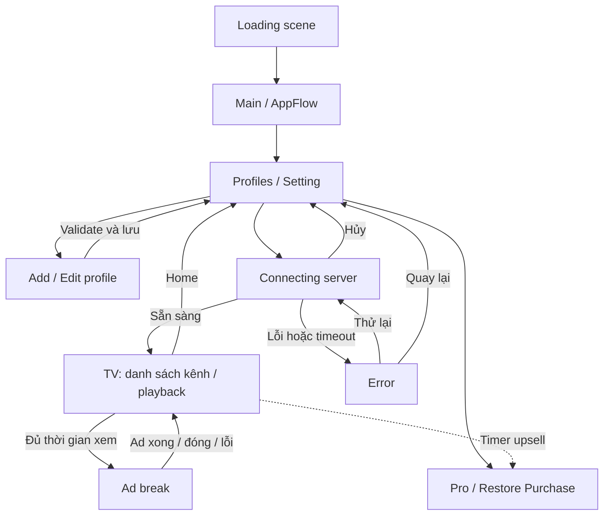

# Kestrel IPTV Player

App Android (Unity 6000.6 + lớp native Java `StbHost`) xem Live TV từ server **Xtream Codes** bằng Server URL + username + password. Danh sách kênh, EPG và player là view native; Unity giữ luồng app, quảng cáo, IAP và Firebase.

Tên namespace (`StbEmu.*`), package Java (`com.stbemu.host`), menu Editor (`StbEmu/...`) và key PlayerPrefs (`StbEmu.*`) là di sản từ dự án StbEmu và **được giữ nguyên** để không làm mất dữ liệu người dùng; đừng đổi tên khi chưa có kế hoạch migrate. Tên tiếng Anh "portal" trong code (`PortalSession`, `AndroidPortalView`, `portal.ready`...) nay chỉ có nghĩa "kết nối tới server Xtream".

## Cách dùng tài liệu khi làm việc

README mô tả flow hiện tại, đối chiếu code ngày **2026-10-20**. Trước khi sửa một luồng, đọc phần tương ứng ở đây rồi kiểm tra code tại các điểm vào được chỉ rõ.

- Yêu cầu mới của người dùng quyết định phạm vi thay đổi. Code là bằng chứng về hành vi đã triển khai; plan/spec mô tả mục tiêu và quyết định thiết kế, không tự chứng minh tính năng đã có.
- Khi đổi hành vi, cập nhật đồng thời README và tài liệu liên quan. Plan đã làm xong thì xóa hoặc sửa, đừng để lại checklist cũ như công việc còn thiếu.
- Không coi kết quả test ghi từ lần trước là kiểm chứng của thay đổi mới. Ghi rõ phần chưa chạy trên thiết bị.

## Flow tổng thể

### Khởi động và profile

Theme mặc định là **Dark** khi chưa có lựa chọn được lưu; nếu người dùng đã chọn System, Light hoặc Dark trong Setting thì giữ lựa chọn đó.

`Loading` tải `Main` bất đồng bộ. `AppFlow` tạo canvas từ prefab được gán (hoặc Resources), khởi tạo adapter và đọc profile qua `ProfileManager` / `JsonProfileRepository` (`profiles.json`, schema v2; file có schema khác bị coi là rỗng). Mở trực tiếp Main trong Editor cũng được. Firebase, Remote Config, ads và IAP khởi tạo theo lifecycle riêng, không chặn màn Profiles.

Android dùng `AndroidProfileUi` → `HomeScreen` / `ProfileEditorDialog` native với tab Profile và Setting; Editor dùng `CanvasProfileUi` (playback chỉ chạy trên Android). Profile gồm tên, Server URL, username, password và tùy chọn nâng cao (User-Agent API, User-Agent player). `ServerAddress.Normalize` chuẩn hoá URL (thêm `http://`, bỏ `/player_api.php…`, `/get.php…`, `/` cuối); `ProfileValidator` yêu cầu đủ trường và không trùng `(ServerUrl, Username)`. Password lưu dạng thường trong bộ nhớ riêng của app và không bao giờ được log hay gửi lên analytics.

App **khóa portrait**; chỉ video fullscreen mới xoay sang landscape. Native `TvScreen` báo `ui.fullscreen` (`portrait` / `landscape` / `landscape-fixed`): fullscreen luôn landscape, và nếu auto-rotate của hệ thống đang bật thì xoay được hai chiều, nếu tắt thì giữ một chiều; toggle auto-rotate được theo dõi trong lúc fullscreen. `AppFlow.SetFullscreenOrientation` áp dụng.

Điểm vào: [AppFlow](Assets/App/UI/AppFlow.cs), [AndroidProfileUi](Assets/App/Infrastructure/Android/AndroidProfileUi.cs), [ProfileManager](Assets/App/Domain/Profiles/ProfileManager.cs). Chi tiết: [App startup](Docs/AppStartup.md).

### Connect, chọn kênh và playback

1. Chọn profile → validate → ẩn Home → Connecting. `ConnectAsync` dừng phiên phát cũ, tạo `PortalSession` (snapshot profile) và gọi `AndroidPortalView.OpenAsync` → `StbHost.openPortal`. Timeout tầng AppFlow là **180 giây**; native có các watchdog riêng nên có thể báo lỗi sớm hơn.
2. Java (`XtreamClient`) gọi `player_api.php`: `authenticate` (phase `AUTHENTICATING`) → `get_live_categories` + `get_live_streams` (phase `LOADING`); `XtreamCatalog` đổi sang payload `channels.data` cho `TvScreen`. C# không tải danh sách kênh.
3. Sẵn sàng → vào TV, bật overlay. Lỗi → Error với Retry/Back (`PortalFailurePolicy` quyết định lỗi nào được retry, `ErrorText` ra câu thông báo); Cancel hủy tác vụ và về Profiles. Callback của lần connect đã bị thay thế không được điều hướng phiên mới.
4. Chọn kênh: native ghép URL `{server}/live/{user}/{pass}/{streamId}.{m3u8|ts}` và phát bằng Media3. Live `.ts` đi qua `ReconnectingTsDataSource` để nối lại khi server ngắt định kỳ ([live .ts](Docs/LIVE_TS_RECONNECT.vi.md)); codec dùng `HevcDecoderSelector` ([HEVC](Docs/HEVC_PLAYBACK_FIX.vi.md)).
5. Home đóng kết nối, dừng player, hủy tác vụ đang chờ và về Profiles. Back trên TV do native xử lý, không mặc định là Home.
6. Mất kết nối khi đang xem: native phát `ui.refresh` / `ui.portal-reconnect`, `AppFlow.ReconnectPortalAsync` mở lại phiên (timeout 180 giây) mà không dừng stream đang chạy; thất bại reconnect không được phá stream. Lỗi mạng retry có giới hạn một lần tự động rồi mới báo; link/tài khoản hết hạn hoặc vượt số kết nối (`MAX_CONNECTIONS`) báo đúng mã.

Điểm vào Java: [StbHost](Native/StbHost/src/main/java/com/stbemu/host/StbHost.java), [XtreamClient](Native/StbHost/src/main/java/com/stbemu/host/XtreamClient.java), [XtreamCatalog](Native/StbHost/src/main/java/com/stbemu/host/XtreamCatalog.java), [TvScreen](Native/StbHost/src/main/java/com/stbemu/host/TvScreen.java). Thiết kế: [Xtream Live](Docs/superpowers/specs/2026-10-12-xtream-live-design.vi.md).

Tracking kết nối: event Firebase `server_connect` (`url`, `user`, `status`, `error`), gửi từ `AppFlow.TrackConnect`. Không gửi password.

### Ads, ad break và upsell

`GoogleAdsMobileController` quản lý consent UMP, tải/show ads và cooldown; quyền Pro chặn mọi request/load/show, không có cờ tắt ads qua Remote Config. Format: Banner, Interstitial, Rewarded, Rewarded Interstitial, App Open, Native ([Firebase/AdMob](Docs/FirebaseAndAdMob.md), [banner layout](Docs/BannerLayout.md)). App Open có policy startup/resume riêng và bị suppress khi connect, khi có full-screen ad hoặc ad break.

- Interstitial có các điểm gọi khi về Home và đổi kênh; việc show còn phụ thuộc ad sẵn sàng và timing policy. Chọn kênh đầu tiên không tự tính là đổi kênh.
- `StreamingAdPolicy` cộng thời gian khi đang phát, app không pause, không chuyển quảng cáo. Đổi kênh không reset thời gian xem. `rewardedViewingSeconds = 0` tắt ad break.
- **Ad break là bắt buộc**: đủ thời gian xem → popup đếm ngược 3 giây → Rewarded (hoặc Rewarded Interstitial nếu Rewarded chưa sẵn sàng). Không có nút từ chối. Ad xem đủ, đóng sớm hoặc lỗi đều bắt đầu một chu kỳ mới; chưa có ad sẵn sàng thì hỏi lại sau 10 giây.
- Khoảng thời gian ad break rút ngắn theo tổng thời gian xem tích lũy: mỗi 600 giây bớt 10 giây, sàn 60 giây.
- Mọi timing đọc qua `MonetizationController` ([thiết kế](Docs/ProMonetizationDesign.vi.md)): Remote Config là raw, runtime nhân hệ số segment `engaged` rồi clamp min/max (`MonetizationPolicy`, version 2, sáu timing). Segment: `pro` / `engaged` (xem ≥30 phút và ≥2 ngày trong 7 ngày UTC) / `casual`. Timing mới chỉ áp dụng khi rời stream.
- **Upsell Pro** là timer trong `AppFlow`: mỗi `upsellIntervalSeconds` thời gian app với user không phải Pro (không khi đang có full-screen ad, consent hoặc ad break) hiện dialog "Upgrade to Pro". Pro ẩn dialog. Upsell khi bấm item bị khóa là luồng riêng.
- Native ad vẽ bằng Java (`NativeAdController`) trong Home và danh sách kênh/EPG; bật khi đủ `sessionShowNative` session và có ad unit ID.
- Khi ads che màn hình, native giữ media source, vị trí và buffer còn lại trong player; đóng ads tiếp tục phần đã giữ, không seek về live edge vô điều kiện. Lỗi lúc ads/background được xử lý khi playback được phép tiếp tục, recovery có ngân sách và không lặp reload vô hạn.

Điểm vào: [AppFlow](Assets/App/UI/AppFlow.cs), [StreamingAdPolicy](Assets/App/Services/StreamingAdPolicy.cs), [GoogleAdsMobileController](Assets/App/Services/GoogleAdsMobileController.cs), [MonetizationController](Assets/App/Services/MonetizationController.cs).

### Pro, subscription và Restore Purchase

Codeless IAP auto-init đã tắt. SDK vẫn có thể query cả hai loại sản phẩm khi lấy lại focus; app chặn tự cấp order Forever từ luồng này. Fetch xác minh subscription giữ cache Forever; chỉ mua Forever hoặc Restore Purchase mới nhận quyền Forever từ kết quả fetch.

| Thao tác | Hành vi hiện tại |
| --- | --- |
| Mở app / resume | Kiểm tra quyền subscription bằng query `SUBS` qua native. Không tự fetch quyền Pro Forever; giữ cache lifetime. Catalog/giá vẫn được tải để phục vụ mua hàng. |
| Subscription đã hủy gia hạn nhưng còn hạn | Vẫn có Pro nếu Google Play còn trả về quyền subscription đang hiệu lực. |
| Subscription hết hạn | Query thành công không còn subscription → bỏ quyền subscription, giữ Pro Forever nếu đã cache. |
| Query lỗi/offline | Giữ quyền đã cache, không coi lỗi mạng là hết hạn. |
| Mua Monthly / Yearly | Product `kestrel_pro`, base plan `monthly` / `yearly`; native chọn offer và mở Google Play, Unity IAP xác minh/cấp quyền/confirm. |
| Mua Pro Forever | Product non-consumable `kestrel_pro_forever`, qua Unity IAP; chặn khi subscription còn hiệu lực. |
| Restore Purchase | Restore và fetch **cả subscription lẫn Pro Forever**. Không áp giới hạn SUBS-only của luồng tự động. |

`IsPro` là có lifetime hoặc subscription còn hiệu lực. Pending payment chưa thanh toán không cấp Pro. Đổi lên Yearly dùng `CHARGE_FULL_PRICE`; đổi sang Monthly dùng `WITHOUT_PRORATION`. Không có backend tự hủy subscription; người dùng hủy gia hạn trong Google Play.

Điểm vào: [InAppPurchaseController](Assets/App/Services/InAppPurchaseController.cs), [SubscriptionPlanPurchases](Assets/App/Services/SubscriptionPlanPurchases.cs), [SubscriptionPlans.java](Native/StbHost/src/main/java/com/stbemu/host/SubscriptionPlans.java). Chi tiết: [Pro plans](Docs/ProSubscriptionPlans.md).

### Phần chưa triển khai

[Plan giới hạn HD/VIP](Docs/superpowers/plans/2026-10-07-stream-resolution-selection.vi.md) vẫn là đề xuất: runtime không chặn kênh vượt 720p và không chọn chất lượng theo quyền Pro. Ngoài phạm vi Live TV: VOD, Series, catch-up/timeshift, M3U ([spec Xtream](Docs/superpowers/specs/2026-10-12-xtream-live-design.vi.md)).

## Build và kiểm chứng

- **Unity**: 6000.6.3f1. Build dev từ menu **StbEmu > Build And Run Android (Dev)** (`Builds/StbEmu-dev.apk`). `AppVersionSettings.asset` là nguồn của version và `bundleVersionCode` (`AppVersionBuildSync` ghi vào Player Settings trước mỗi build; `AabVersionCodeBump` tăng code cho mỗi build AAB).
- **Java/JNI**: tại `Native/StbHost`, `./gradlew.bat test copyToUnity --offline` với JDK 17 (Android Studio JBR) và Android SDK; lệnh cập nhật `Assets/Plugins/Android/StbHost.aar`, cần commit cùng source Java. AAR chỉ tới app qua một lần build Unity.
- **C#**: chạy EditMode tests trong `Assets/App/Tests/EditMode` (Test Runner, hoặc `Unity.exe -batchmode -nographics -runTests -testPlatform EditMode -testResults <file>` khi Editor đang đóng; không truyền `-quit`). Nhánh `UNITY_ANDROID && !UNITY_EDITOR` chỉ biên dịch khi build Android.
- `Tools/Test-AdServices.ps1` đang hỏng sẵn (xem [ProMonetizationDesign](Docs/ProMonetizationDesign.vi.md) mục 1); dùng EditMode tests thay thế.
- **Thiết bị**: Loading → Profiles → Connect → đổi kênh → fullscreen xoay (auto-rotate bật/tắt) → Home; reconnect khi stream còn chạy; ad break, upsell; banner và native ad; purchase/restore với tài khoản test Google Play. Ghi rõ nếu chưa chạy; JVM/EditMode tests không thay thế kiểm chứng trên thiết bị.

## Cấu hình AdMob và Remote Config

Giá trị gốc nằm trong `Assets/Resources/Services/AdMobSettings.asset`; khi chạy, app dùng asset (hoặc Remote Config) làm raw rồi tính giá trị hiệu lực theo segment và min/max trong `MonetizationPolicy`.

Khi thêm, đổi tên hoặc đổi giá trị cấu hình trong `AdMobSettings`, phải cập nhật đồng bộ Remote Config:

- Các field tương ứng trong `AdMobRemoteConfig` tại `Assets/App/Services/RemoteConfigController.cs`.
- Giá trị mặc định trong `AdMobSettings.asset`.
- Xuất JSON bằng menu **StbEmu > Export AdMob Remote Config JSON** hoặc **Copy Remote Config JSON** trên asset, rồi dán lên Firebase Remote Config.
- Preset theo quốc gia: **StbEmu > admod_setting_tier_1/2/3** xuất asset × hệ số tier (`MonetizationPolicy.TierMultiplier`) kèm field `tier`; người vận hành gán từng file vào condition Country/Region trên Firebase. App đặt user property `tier` từ giá trị này.
- Policy v2 có **sáu** timing (không còn `rewardedSkippedViewingSeconds`); JSON cũ có thể còn field thừa, `JsonUtility` bỏ qua nhưng giá trị hiệu lực sẽ sai nên cần xuất và publish lại.

Key Firebase mà code đọc là `AdMob_Config` (`FirebaseKeyParams.AdMob_Config`) và `AB_Version`. Native ad và Rewarded Interstitial chỉ bật khi có ad unit ID của Kestrel trong asset hoặc Remote Config.
