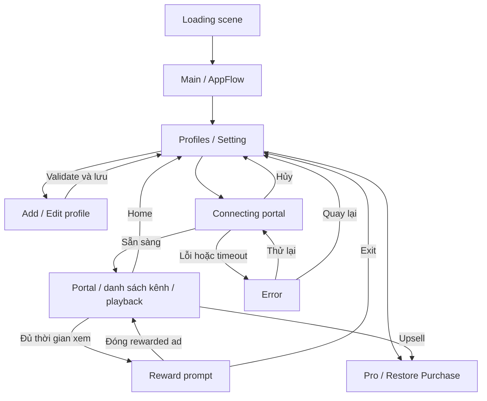

# StbEmu

## Cách dùng tài liệu khi làm việc

README mô tả flow hiện tại, đối chiếu code ngày **2026-10-10**. Trước khi sửa một luồng, đọc phần tương ứng ở đây và plan được liên kết bên dưới, rồi kiểm tra code tại các điểm vào được chỉ rõ.

- Yêu cầu mới của người dùng quyết định phạm vi thay đổi. Code hiện tại là bằng chứng về hành vi đã triển khai; plan mô tả mục tiêu và quyết định thiết kế, không tự chứng minh tính năng đã có.
- Các plan cũ có mục **Hiện trạng 2026-10-10** ở đầu. Dùng mục này cho công việc tiếp theo; phần lịch sử chỉ để tra lý do và các bước từng đề xuất. Không chạy lại checklist cũ như công việc còn thiếu.
- Khi đổi hành vi, cập nhật đồng thời README và hiện trạng của plan liên quan. Ghi rõ phần đã làm, phần chưa triển khai, kiểm chứng đã chạy và phần cần kiểm tra trên thiết bị.
- Không coi kết quả test ghi từ lần triển khai trước là kết quả kiểm chứng của thay đổi mới.

## Flow tổng thể

### Khởi động và profile

Theme mặc định là **Dark** khi chưa có lựa chọn được lưu. Nếu người dùng đã chọn System, Light hoặc Dark trong Setting thì giữ lựa chọn đó.

`Loading` tải `Main` bất đồng bộ. `AppFlow` tạo canvas từ prefab được gán (hoặc Resources), khởi tạo các adapter và đọc profile qua `ProfileManager` / `JsonProfileRepository`. Mở trực tiếp Main trong Editor cũng được hỗ trợ. Các service Firebase, Remote Config, ads và IAP khởi tạo theo lifecycle riêng, không phải các bước tuần tự bắt buộc trước màn Profiles.

Android dùng `AndroidProfileUi` → `HomeScreen` / `ProfileEditorDialog` native với tab Profile và Setting. Editor dùng `CanvasProfileUi`; portal thực chỉ chạy trên Android. Danh sách rỗng hiển thị Add profile, không tự mở form. Add/Edit đi qua validation và lưu ở C#; Java chỉ giữ draft và render UI. Delete cần xác nhận. Dữ liệu profile được giữ qua các lần mở app.

Điểm vào: [AppFlow](Assets/App/UI/AppFlow.cs), [AndroidProfileUi](Assets/App/Infrastructure/Android/AndroidProfileUi.cs), [ProfileManager](Assets/App/Domain/Profiles/ProfileManager.cs). Chi tiết: [App startup](Docs/AppStartup.md), [plan app flow](Docs/superpowers/plans/2026-09-25-app-flow-ui.md), [plan native profile](Docs/superpowers/plans/2026-10-07-native-profile-settings.vi.md).

### Connect, chọn kênh và playback

1. Chọn profile → validate → ẩn Home → Connecting. `ConnectAsync` dừng phiên phát cũ, tạo `PortalSession` và `PortalController`, rồi mở portal. Timeout tầng AppFlow là **180 giây**; native có các watchdog riêng nên có thể trả lỗi sớm hơn.
2. Portal sẵn sàng → vào Portal, bật overlay. Lỗi → Error với Retry/Back; Cancel hủy tác vụ và về Profiles. Callback của lần connect đã bị thay thế không được điều hướng phiên mới.
3. Facade trong WebView cung cấp dữ liệu kênh cho native qua `channels.data`. Native hiển thị danh sách, tìm kiếm, nhóm và favorites; yêu cầu chọn kênh quay lại facade qua `channels.play`. C# không tải danh sách kênh từ Stalker API.
4. Lệnh playback qua bridge được xử lý bởi `PortalController` / `AndroidPlayer` / `StbHost`; Media3 phát stream. Quảng cáo và reward prompt dùng playback gate để điều phối việc phát.
5. Home đóng portal, dừng player, hủy tác vụ đang chờ và về Profiles. Back trong portal đi theo điều khiển native/portal; không mặc định xem Back là Home.

Portal và stream có lifecycle riêng: lỗi WebView khi vẫn có stream không được tự dừng kênh đang xem. Khi cần đổi kênh mà portal unavailable, reconnect portal và tiếp tục yêu cầu chọn kênh. `ReconnectPortalAsync` không gọi luồng connect mới vốn dừng player; thất bại reconnect không được phá stream đang chạy. Khi chưa có stream, lỗi portal vẫn có thể dẫn tới retry/Error. Lỗi CDN/player được xử lý theo policy playback, không tự quy tất cả thành lỗi đăng nhập portal.

Chi tiết: [plan channel list](Docs/superpowers/plans/2026-09-25-native-channel-list.md), [plan tách portal/stream](Docs/superpowers/plans/2026-09-26-portal-stream-lifecycle-decoupling.md), [connect/reload](Docs/ANDROID_PORTAL_CONNECT_RELOAD_IMPLEMENTATION.vi.md), [streaming hiện tại](Docs/STREAMING_IMPLEMENTATION.vi.md), [HEVC](Docs/HEVC_PLAYBACK_FIX.vi.md).

### Ads, reward và upsell

`GoogleAdsMobileController` quản lý consent UMP, tải/show ads và cooldown. Quyền Pro chặn yêu cầu/tải/show ads; không dùng cờ tắt ads từ Remote Config. App Open có policy startup/resume riêng và bị suppress trong các bước connect, full-screen ad hoặc reward prompt cần bảo vệ playback.

- Interstitial có các điểm gọi khi về Home, đổi kênh và reconnect sau khi Exit reward. Việc thực sự show còn phụ thuộc ad sẵn sàng và timing policy; chọn kênh đầu tiên không tự tính là đổi kênh để show interstitial.
- `StreamingAdPolicy` cộng thời gian khi đang phát ở Portal, app không pause, không chuyển quảng cáo và rewarded ad đã sẵn sàng. Đổi kênh không reset thời gian xem. `RewardedViewingSeconds = 0` tắt việc phát sinh reward prompt.
- Đủ thời gian → reward prompt. Nhận reward → reset chu kỳ xem; đóng ad sớm → vẫn về stream, lần nhắc tiếp theo dùng `RewardedSkippedViewingSeconds`. Show lỗi → giữ prompt để thử lại hoặc Exit. Exit về Profiles và đánh dấu cơ hội interstitial khi connect lại.
- Sau reward prompt đầu tiên, nhắc Pro khi quay lại Portal; các lần sau theo `UpsellIntervalSeconds` trong AdMobSettings. Mặc định **90 giây**, tối thiểu **1 giây**; timer chỉ chạy khi ở Portal, không pause/chuyển ads/show full-screen ads. User Pro được ẩn upsell.
- Khi ads che màn hình, native giữ media source, URL/headers, vị trí và buffer còn lại trong player. Đóng ads tiếp tục phần đã giữ; không seek về live edge vô điều kiện. Đây là buffer trong bộ nhớ, không phải tải toàn bộ video xuống đĩa hay bảo đảm timeshift cho live stream.
- Lỗi trong lúc ads/background được xử lý khi playback được phép tiếp tục. Deadline recovery không tính thời gian bị ngắt; media ở IDLE được prepare lại, live đã ENDED được retry. Live window hết hạn → về live edge; lỗi mạng → retry có giới hạn; link hết hạn → lấy link mới, portal unavailable → reconnect. Lỗi định dạng/DRM/codec không khắc phục được và hết ngân sách recovery vẫn báo lỗi, không lặp reload vô hạn.

Điểm vào: [AppFlow](Assets/App/UI/AppFlow.cs), [StreamingAdPolicy](Assets/App/Services/StreamingAdPolicy.cs), [GoogleAdsMobileController](Assets/App/Services/GoogleAdsMobileController.cs). Tham khảo [Firebase/AdMob](Docs/FirebaseAndAdMob.md), [banner layout](Docs/BannerLayout.md).

### Pro, subscription và Restore Purchase

Codeless IAP auto-init đã tắt. SDK vẫn có thể query cả hai loại sản phẩm khi lấy lại focus; app chặn tự cấp order Forever từ luồng này. Fetch xác minh subscription giữ cache Forever; chỉ mua Forever hoặc Restore Purchase mới nhận quyền Forever từ kết quả fetch.

| Thao tác | Hành vi hiện tại |
| --- | --- |
| Mở app / resume | Kiểm tra quyền subscription bằng query `SUBS` qua native. Không tự fetch quyền sở hữu Pro Forever; giữ cache lifetime. Catalog/giá sản phẩm vẫn được tải để phục vụ mua hàng. |
| Subscription đã hủy gia hạn nhưng còn hạn | Vẫn có Pro nếu Google Play còn trả về quyền subscription đang hiệu lực. |
| Subscription hết hạn | Query thành công không còn subscription → bỏ quyền subscription, giữ quyền Pro Forever nếu đã cache. |
| Query lỗi/offline | Giữ quyền đã cache, không coi lỗi mạng là hết hạn. |
| Mua Monthly / Yearly | Product `premium_monthly`, base plan `monthly` / `yearly`; native chọn offer và mở Google Play, Unity IAP xác minh/cấp quyền/confirm. |
| Mua Pro Forever | Product non-consumable `remove_ads`, qua Unity IAP; chặn khi subscription còn hiệu lực. |
| Restore Purchase | Restore và fetch **cả subscription lẫn Pro Forever**. Không áp giới hạn SUBS-only của luồng tự động. |

`IsPro` là có lifetime hoặc subscription còn hiệu lực. Pending payment chưa thanh toán không cấp Pro; order đã thanh toán nhưng chờ acknowledgement được xử lý riêng bởi IAP. Đổi lên Yearly dùng `CHARGE_FULL_PRICE`; đổi sang Monthly dùng `WITHOUT_PRORATION`. Không có backend tự hủy subscription; người dùng hủy gia hạn trong Google Play. Không suy hạn gói Yearly từ metadata của base plan đầu tiên.

Điểm vào: [InAppPurchaseController](Assets/App/Services/InAppPurchaseController.cs), [SubscriptionPlanPurchases](Assets/App/Services/SubscriptionPlanPurchases.cs), [SubscriptionPlans.java](Native/StbHost/src/main/java/com/stbemu/host/SubscriptionPlans.java). Chi tiết: [Pro plans](Docs/ProSubscriptionPlans.md).

### Phần chưa triển khai

[Plan giới hạn HD/VIP](Docs/superpowers/plans/2026-10-07-stream-resolution-selection.vi.md) vẫn là đề xuất: runtime hiện chưa có policy chặn kênh vượt 720p hay chọn chất lượng theo quyền Pro. Không dùng plan đó để kết luận app đang giới hạn HD. Billing Pro đã tồn tại độc lập; nếu làm resolution gate cần nối vào entitlement hiện có.

## Kiểm chứng khi thay đổi

- C# flow/profile: chạy EditMode tests phù hợp trong `Assets/App/Tests/EditMode`; kiểm tra nhánh Android vì Editor không chạy WebView/native bridge.
- Policy quảng cáo: chạy `Tools/Test-AdServices.ps1`.
- Java/JNI: tại `Native/StbHost`, chạy `./gradlew.bat test copyToUnity --offline` với JDK/Android SDK phù hợp; cập nhật `Assets/Plugins/Android/StbHost.aar` cùng source Java. Đổi facade cần chạy các kiểm tra liên quan trong `Native/StbHost/test`.
- Smoke thiết bị theo phần thay đổi: Loading → Profiles → Connect → đổi kênh → Home; portal reconnect khi stream còn chạy; reward/upsell; purchase/restore với tài khoản test Google Play. Ghi rõ nếu chưa chạy, không thay thế kiểm chứng thiết bị bằng JVM tests.

## Cấu hình AdMob và Remote Config

Asset hiện tại đặt `rewardedViewingSeconds = 480`, `rewardedSkippedViewingSeconds = 240` và `upsellIntervalSeconds = 180` (giây). Giá trị khởi tạo trong class có thể khác; khi chạy, app dùng asset và các giá trị Remote Config được áp dụng.

Khi cập nhật `AdMobSettings` (thêm, đổi tên hoặc thay đổi giá trị cấu hình), phải cập nhật đồng bộ Remote Config của `ad_config`.

- Cập nhật các field tương ứng trong `AdMobRemoteConfig` tại `Assets/App/Services/RemoteConfigController.cs`.
- Cập nhật giá trị mặc định trong `Assets/Resources/Services/AdMobSettings.asset`.
- Xuất JSON bằng menu **StbEmu > Export AdMob Remote Config JSON** hoặc **Copy Remote Config JSON** trên asset, rồi cập nhật giá trị trên Firebase Remote Config.

Lưu ý: key Firebase hiện được code sử dụng là `AdMob_Config` (`FirebaseKeyParams.AdMob_Config`). Khi cập nhật `ad_config` trên Firebase, cần dùng đúng key này để app đọc được cấu hình.
