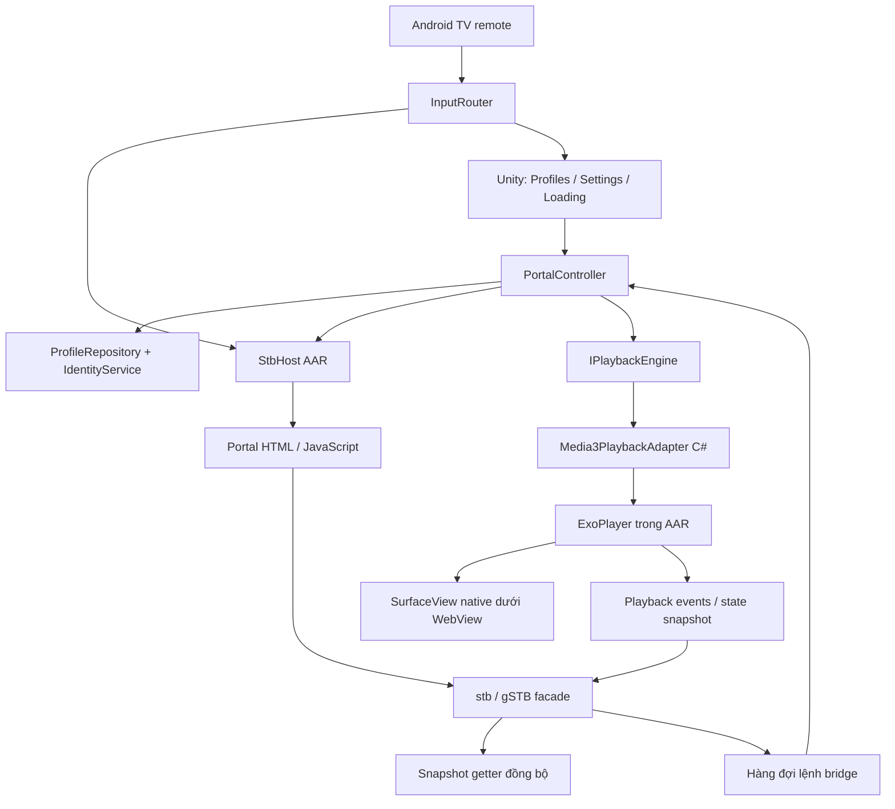

# Blueprint: ứng dụng STB trên Unity + ExoPlayer / Media3 (Native Android Plugin)

Ngày: 25/09/2026 · Trạng thái: thiết kế triển khai, chưa phải project đã build.
Thay đổi: chuyển engine phát từ VLC for Unity (trả phí) sang AndroidX Media3 ExoPlayer (Apache 2.0, miễn phí) nằm trong AAR native tự viết.

## 1. Mục tiêu và quyết định kiến trúc

Xây dựng ứng dụng Android/Android TV cho phép người dùng tạo profile gồm Portal URL, MAC giả lập và các thông tin đầu thu; tải giao diện web của portal; cung cấp API JavaScript tương thích với một tập con MAG/STB; phát stream bằng ExoPlayer (AndroidX Media3).

**Kiến trúc chọn cho MVP: Unity quản lý ứng dụng + một AAR native (Java) chứa Android WebView hiển thị portal, bridge MAG/STB và Media3 ExoPlayer phát video lên `SurfaceView` native.** ExoPlayer không thực hiện đăng nhập portal hoặc giả lập đầu thu. Những phần đó thuộc lớp portal và bridge.

WebView và player nằm chung một AAR nên lệnh `Play` từ portal có thể đi thẳng tới ExoPlayer trên Android UI thread; Unity chỉ nhận event trạng thái và điều phối session. Video không đi qua texture Unity.

Mục tiêu tương thích ban đầu là **một portal thử nghiệm được phép sử dụng**, với bộ chức năng đã đo được. Không coi “tương thích mọi Stalker/Ministra/MAG” là yêu cầu MVP: từng portal có thể dùng API, cách xác thực và callback khác nhau.

Giả định để bắt đầu:

- Android/Android TV là nền tảng đích duy nhất cho playback. Media3 chỉ chạy trên Android; trong Windows Editor dùng `FakePlaybackEngine` để thử logic, không có video thật.
- Chọn Unity LTS có Gradle/AGP đủ mới để build Media3 bản đang chọn (kiểm tra `compileSdk`/`minSdk` yêu cầu trong release notes Media3).
- IL2CPP, ARM64 (thêm ARMv7 nếu TV box đích 32-bit) là cấu hình thử nghiệm đầu tiên. Graphics backend Unity (GLES3/Vulkan) không ảnh hưởng playback vì video render trên surface native riêng.
- Decode dựa vào `MediaCodec` phần cứng của thiết bị; codec thiết bị không hỗ trợ thì không phát được (xem mục 8 về FFmpeg extension).
- Một profile/portal hoạt động tại một thời điểm, một video chính, chưa có PIP, DRM hay ghi hình.
- Profile do người dùng nhập hoặc import. Ứng dụng không dò MAC, không tìm tài khoản, không suy host từ MAC.

### Căn cứ từ XAPK đã phân tích

Gói `com.mvas.stb.emu.free` v2.0.23.01 lưu `portal_url` và `mac_address` trong bảng `profiles`. `gSTB.GetDeviceMacAddress()` đọc MAC của profile. Có cầu nối `stb/gSTB`, các hàm `Play`, `GetUID`, và nhiều engine phát media. Mã tạo profile mới chọn MAG424; asset mẫu cũ ghi MAG250.

Xem [bằng chứng phân tích tĩnh](StbEmu-bang-chung.md). Các tên lớp làm rối trong tệp đó chỉ dùng truy vết; không dùng làm tên lớp sản phẩm mới. Chưa có capture của portal thực tế nên không xem một chuỗi handshake/token cụ thể là đã xác nhận.

## 2. Package và thành phần cần chuẩn bị

| Thành phần | Mức cần thiết | Cách dùng |
|---|---|---|
| Native host `.aar` tự viết bằng Java (`StbHost`) | Bắt buộc | Chứa WebView, ExoPlayer, `SurfaceView` video, vòng đời, bridge, xử lý remote và overlay; không phải package có sẵn của Unity |
| `androidx.media3:media3-exoplayer` | Bắt buộc | Engine phát; Apache 2.0 [S1] |
| `androidx.media3:media3-exoplayer-hls` | Bắt buộc (IPTV phần lớn là HLS) | HLS/m3u8 |
| `androidx.media3:media3-exoplayer-dash`, `-rtsp`, `-datasource-rtmp` | Tùy chọn | Chỉ thêm khi portal thử nghiệm dùng giao thức đó |
| `androidx.media3:media3-datasource-okhttp` | Hoãn | Thêm khi cần lọc cookie/header theo host; MVP dùng `DefaultHttpDataSource` |
| `androidx.webkit:webkit` | Bắt buộc cho bridge document-start chọn trong tài liệu | Dependency Gradle của AAR; chốt bản tương thích với Unity/Gradle và kiểm tra feature runtime [S5] |
| UniTask — `com.cysharp.unitask` | Khuyến nghị mạnh; các interface mẫu dưới dùng UniTask | Cancellation, timeout, chuyển main thread, phối hợp tải portal/player [S2] |
| `com.unity.nuget.newtonsoft-json` | Khuyến nghị; chọn cho blueprint này | JSON profile và thông điệp bridge; dùng bản tương thích Unity [S3] |
| Unity UI (`com.unity.ugui`) | Chọn cho UI MVP | Profile/settings, màn hình lỗi, loading; không dùng để hiển thị video |
| Input System (`com.unity.inputsystem`) | Tùy chọn | Cần khi project chọn Unity Input System; remote gửi tới WebView vẫn cần native routing |
| Unity Test Framework (`com.unity.test-framework`) | Development | Kiểm tra identity, lưu profile, state machine và session cancellation |
| `gree/unity-webview` | Phương án thay thế cho phần host, không cài song song mặc định | Có WebView và trao đổi JS; phải kiểm chứng/mở rộng injection sớm, getter đồng bộ, overlay và remote [S4] |
| SQLite, VContainer, R3/UniRx, Addressables | Chưa cần MVP | Chỉ thêm khi quy mô hoặc kiến trúc project chứng minh cần |

**Bộ tối thiểu:** Unity project + Android Studio để build AAR. Không cần mua plugin nào: Media3, AndroidX WebKit, UniTask, Newtonsoft đều miễn phí.

Dependency Gradle của AAR (Media3, webkit) **không đi kèm file `.aar`**; phải khai báo trong Unity bằng Custom Main Gradle Template (`Assets/Plugins/Android/mainTemplate.gradle`) hoặc EDM4U. Blueprint chọn `mainTemplate.gradle` vì ít phụ thuộc nhất:

```gradle
dependencies {
    def media3 = '1.11.1'
    implementation "androidx.media3:media3-exoplayer:$media3"
    implementation "androidx.media3:media3-exoplayer-hls:$media3"
    implementation 'androidx.webkit:webkit:1.17.1'
**DEPS**}
```

Tất cả module Media3 phải cùng một version.

UniTask có thể thêm bằng Git URL trong Package Manager:

```text
https://github.com/Cysharp/UniTask.git?path=src/UniTask/Assets/Plugins/UniTask
```

Sau khi chọn release, pin tag/commit thay vì theo nhánh mặc định. Ghi bản Unity, AGP/Gradle, Media3, AndroidX WebKit, UniTask và Newtonsoft trong `Docs/dependency-lock.md`. Không để hai plugin Unity khác nhau cùng kéo ExoPlayer (bản cũ `com.google.android.exoplayer2` hoặc Media3 khác version) để tránh trùng class khi build. [S1, S2]

## 3. Hai cách làm portal và lý do chọn

| Hướng | Cách vận hành | Phạm vi |
|---|---|---|
| WebView + STB bridge — chọn | Portal tự chạy HTML/JS; bridge cung cấp API đầu thu; ExoPlayer native xử lý playback | Gần mô hình ứng dụng đã phân tích |
| Unity UI + client API trực tiếp | Tự viết login, channel list, EPG, giải link phát theo API nhà cung cấp | Có thể làm sau khi có tài liệu giao thức; không cần WebView nhưng phải tự triển khai nhiều nghiệp vụ |

Không trộn hai hướng trong MVP. Với hướng WebView, session và logic xác thực trước hết thuộc portal. Không đồng thời tự chạy một chuỗi `handshake/get_profile/create_link` chưa được xác minh trong C#.

## 4. Sơ đồ thành phần



Trách nhiệm cụ thể:

- `ProfileRepository`: đọc/ghi JSON có schema version và backup; không chứa logic portal.
- `IdentityService`: tạo, chuẩn hóa và giữ ổn định MAC/serial/device ID; không đổi định danh khi refresh.
- `PortalController`: session lifecycle, cancel khi đổi profile, chuyển state và điều phối player.
- `AndroidPortalView`: tạo/destroy WebView, nạp trang, origin rules, snapshot và callback.
- `StbApiFacade`: lớp JS nhỏ, tương thích các API portal mục tiêu thực sự gọi.
- `BridgeDispatcher`: xác thực message, giới hạn kích thước, xếp lệnh theo session.
- `Media3PlaybackAdapter` (C#): duy nhất lớp gọi `AndroidJavaObject` tới phần player của AAR; phía Java là `StbHost` bọc ExoPlayer + WebView.
- `InputRouter`: xác định một nơi nhận phím tại một thời điểm.
- `Diagnostics`: log lỗi và timing đã che thông tin định danh/session.

## 5. Mô hình profile và định danh

Ví dụ dữ liệu **minh họa**, không phải thông tin truy cập thực:

```json
{
  "schemaVersion": 1,
  "profileId": "8af84123-e4bb-44a3-a3b0-d6084540f643",
  "name": "Test portal",
  "portalUrl": "https://portal.example.test/c/",
  "identity": {
    "mac": "00:1A:79:12:34:56",
    "serialNumber": "USER-CONFIGURED",
    "model": "MAG250",
    "deviceIdMode": "Explicit",
    "deviceId": "",
    "sendDeviceId": false
  },
  "compatibility": {
    "adapterId": "test-portal-v1",
    "userAgentOverride": "",
    "portalLanguage": "en",
    "timezone": "Asia/Ho_Chi_Minh"
  },
  "playback": {
    "minBufferMs": 2000,
    "tunneling": false
  }
}
```

`minBufferMs` map sang `DefaultLoadControl.Builder().setBufferDurationsMs(...)`; `2000` là giá trị thử nghiệm, phải đo trên thiết bị và giao thức đích. `tunneling` map sang `DefaultTrackSelector` tunneling mode, chỉ bật khi TV đích chứng minh ổn định.

### MAC

1. Cho phép người dùng nhập MAC do dịch vụ gán.
2. Chuẩn hóa thành sáu byte hex, chữ hoa, ngăn bằng dấu hai chấm; validate bằng `^(?:[0-9A-F]{2}:){5}[0-9A-F]{2}$`.
3. Nếu chưa có, có thể sinh ba byte bằng `RandomNumberGenerator`, ghép `00:1A:79`, rồi lưu một lần. Prefix này phục vụ profile tương thích mục tiêu; không phải MAC mạng của máy.
4. Không tự đổi MAC khi mở app, đổi mạng, retry hoặc reload portal. Kiểm tra trùng giữa các profile khi tạo mới.
5. Không phụ thuộc vào quyền đọc MAC phần cứng. Không sửa MAC của Android.

Đây là thiết kế mới có chủ đích, không sao chép nhánh fallback Android ID của ứng dụng cũ. Đuôi ngẫu nhiên 24 bit không bảo đảm duy nhất toàn cầu; nhà cung cấp vẫn cần đăng ký/kiểm tra định danh.

### Device ID

MVP hỗ trợ `Explicit` và tùy chọn không gửi. Chỉ bổ sung `MacSha256` hoặc chế độ signature khi tài liệu/capture của portal chứng minh yêu cầu. Nếu dùng hash, phải cố định casing, dấu phân cách, encoding và cách xuất hex. Cùng tên thuật toán không bảo đảm cùng Device ID.

Không tự dùng Android ID của app mới để kỳ vọng trùng app cũ. Không xem HMAC/Device ID là cơ chế tự tạo quyền thuê bao. Mọi reset identity phải là thao tác riêng của người dùng, không nằm trong retry.

### Lưu trữ

MVP: `Application.persistentDataPath/profiles.json`, ghi file tạm cùng thư mục rồi thay thế với phương án backup tương thích Android; kiểm tra khôi phục sau khi ghi gián đoạn. Token và cookie không trộn vào file profile xuất ra. Không bật Newtonsoft `TypeNameHandling` cho JSON import.

## 6. Bridge: yêu cầu quan trọng nhất

Nhiều portal kỳ vọng getter như `gSTB.GetDeviceMacAddress()` trả string **ngay trong lần gọi**. Một message JS → Unity → JS bất đồng bộ không thay thế được getter đó.

Phương án chọn:

1. Trước khi load portal, Unity gửi snapshot bất biến của profile cho native host.
2. Host đăng ký bridge thông điệp có origin rules và cài script facade ở document-start.
3. Getter JS đọc snapshot tại chỗ; lệnh playback gửi message bất đồng bộ.
4. Sự kiện player được gửi trở lại JS và cập nhật snapshot trạng thái.

`WebViewCompat.addDocumentStartJavaScript(...)` và `addWebMessageListener(...)` là API AndroidX cần kiểm tra hỗ trợ runtime. Nếu WebView thiếu tính năng bắt buộc, MVP báo cần cập nhật WebView; không lặng lẽ inject ở page-finished vì portal có thể đã lỗi trước đó. [S5]

`addJavascriptInterface` là phương án native khác cho getter đồng bộ, nhưng object có thể lộ cho các frame trong WebView. Không coi kiểm tra URL của trang chính là đủ để kiểm soát iframe. Blueprint chọn facade + message listener có kiểm tra origin/main-frame, chưa chọn bridge Java rộng cho mọi trang. [S6]

### API tương thích ban đầu

| API facade dự kiến | Hành vi | Tình trạng |
|---|---|---|
| `GetDeviceMacAddress()` | String MAC trong snapshot | Có bằng chứng trong XAPK |
| `GetDeviceSerialNumber()` | String serial | Có bằng chứng |
| `GetDeviceModel()` | Model đã cấu hình | Có bằng chứng |
| `GetUID()` | Device ID hoặc string rỗng theo cấu hình | Có bằng chứng; portal cụ thể vẫn phải kiểm chứng |
| `GetUID(challenge)` | Định nghĩa theo adapter/portal | Chưa đưa vào MVP mặc định |
| `Play(command)` | Parse command, tạo lệnh playback | Có bằng chứng tên; grammar cần fixture |
| `Stop()`, `Pause()`, `Continue()` | Adapter điều khiển player | Phải xác minh tên/semantics portal cần |
| `GetVolume()`, `SetVolume(...)` | Map đơn vị và giới hạn | Phải xác minh |
| `GetEnv(...)`, `SetEnv(...)` | Map các key được hỗ trợ | Không triển khai đọc/ghi hệ thống tùy ý |
| Callback sự kiện player | Translate event sang portal | Chốt từ tài liệu/capture; không đoán mã sự kiện |

Hai tên `window.stb` và `window.gSTB` có thể cùng trỏ tới facade khi adapter mục tiêu yêu cầu. Mỗi API phải có bảng chữ ký, kiểu trả về, đơn vị, side effect và test fixture. Không giả vờ trả thành công cho API chưa hỗ trợ.

### Message nội bộ đề xuất

```json
{
  "version": 1,
  "sessionId": "opaque-session-id",
  "requestId": "42",
  "type": "player.play",
  "payload": { "command": "https://media.example.test/live.m3u8" }
}
```

Native/C# kiểm tra schema, session, type, URL scheme và giới hạn độ dài. Không nhận tên phương thức C# tùy ý, code để eval, shell command hoặc đường dẫn file tùy ý. Prefix kiểu `ffmpeg ...` của portal phải được parser chuyển thành dữ liệu; tuyệt đối không đưa nguyên chuỗi cho shell.

Khi script được ghép với profile, serialize JSON đúng chuẩn và escape ký tự cần thiết; không nối chuỗi raw từ ô nhập của người dùng.

## 7. Portal session và bàn giao stream cho ExoPlayer

Luồng mở profile:

1. Validate URL đầy đủ gồm scheme, host, port và path. Giữ path/query cần thiết; không rút URL xuống chỉ còn hostname.
2. Dừng player và hủy session cũ; tăng `sessionGeneration`.
3. Tạo snapshot identity, bridge và WebView phù hợp session mới.
4. Nạp portal; portal thực hiện nghiệp vụ xác thực của chính nó.
5. Nhận lệnh `Play`; parser phân tích thành `PlaybackRequest`.
6. Resolve yêu cầu headers/cookie/redirect theo adapter đã kiểm chứng.
7. `StbPlayer` tạo `MediaItem` + `MediaSource` và gọi `prepare()`/`play()`; `Player.Listener` quay lại state machine và facade.

**WebView cookie jar không mặc nhiên dùng chung với ExoPlayer.** Với stream URL ký sẵn, có thể không cần chuyển cookie. Nếu cần cookie/header, chỉ chuyển đúng phạm vi host/path/scheme và tài liệu giao thức cho phép; không đẩy toàn bộ cookie hoặc token sang CDN khác.

`PlaybackRequest` nên chứa URL, headers có phạm vi, referrer nếu cần, expiration nếu biết và playback options có kiểu dữ liệu.

Media3 hỗ trợ header tùy ý qua `HttpDataSource.Factory.setDefaultRequestProperties(...)` (User-Agent, Referer, Cookie, Authorization) và `setUserAgent(...)`; header áp dụng cho playlist, segment và key request của HLS. Với OkHttp data source có thể gắn `CookieJar`/interceptor để chỉ gửi cookie đúng host. Đây là ưu thế chính so với VLC. [S9]

Header mặc định áp dụng cho **mọi host** mà player gọi. Nếu segment nằm trên CDN khác host portal, dùng interceptor lọc theo host thay vì gắn cookie/token toàn cục. Vẫn phải thử playlist, segment, redirect và URL hết hạn trên stream thật; nếu không truyền được dữ liệu xác thực cần thiết, dừng ở compatibility gate.

Giao thức ExoPlayer không có sẵn: `udp://` multicast chỉ có `UdpDataSource` cơ bản cho MPEG-TS (phải thử, không có RTP-over-UDP); portal gửi URL kiểu `ffmpeg http://...` phải được parser bóc prefix.

Không tự viết HTTP proxy cục bộ trong MVP. Nó kéo theo range requests, HLS/DASH rewriting, cookie policy, bảo mật và tải bộ nhớ.

MVP tách cookie/storage khi đổi profile bằng reset session có kiểm chứng; không hứa duy trì nhiều phiên đăng nhập độc lập. WebView dùng chung data store có thể chia sẻ dữ liệu dù tạo object mới. Chỉ triển khai lưu nhiều session khi đã chọn được cơ chế isolation phù hợp.

## 8. Media3 adapter, vòng đời và hiển thị

### Cách render: SurfaceView native (chọn)

AAR thêm vào `FrameLayout` gốc của Unity activity theo thứ tự từ dưới lên:

```text
Unity SurfaceView (UI profile/settings)
  └─ Video SurfaceView  — setZOrderMediaOverlay(true), ExoPlayer.setVideoSurfaceView(...)
       └─ WebView       — setBackgroundColor(TRANSPARENT), portal + OSD
```

Portal vẽ OSD trong suốt đè lên video giống STB thật; không cần copy frame vào Unity. Khi không phát, ẩn video SurfaceView để Unity UI hiện ra. Hai SurfaceView chồng nhau (Unity + video) là điểm phải kiểm chứng ở Phase 1 trên TV đích; nếu Z-order sai, fallback dùng `TextureView` cho video (chậm hơn, tốn pin hơn nhưng compositing chắc chắn).

Phương án bỏ qua cho MVP: render ExoPlayer vào `SurfaceTexture` → `GL_TEXTURE_EXTERNAL_OES` → `Texture2D.CreateExternalTexture` trong Unity. Chỉ cần khi video phải nằm trong scene 3D/shader Unity; phức tạp hơn (chia sẻ GL context, không chạy trên Vulkan nếu không làm thêm).

### Codec

ExoPlayer dùng `MediaCodec` của thiết bị. Khác VLC, **không có software decoder video** cho MPEG-2/H.264 khi thiết bị thiếu. Audio AC3/E-AC3/MP2 thường gặp trên IPTV: bật `DefaultRenderersFactory.EXTENSION_RENDERER_MODE_PREFER` với **FFmpeg audio extension** (`media3-decoder-ffmpeg`, phải tự build; FFmpeg LGPL). Chỉ build khi stream test chứng minh cần. Ghi kết quả codec từng kênh test vào `portal-compatibility.md`.

### Chính sách vòng đời

- Một `ExoPlayer` instance dùng lâu dài cho MVP; chuyển kênh dùng `setMediaItem` + `prepare()` trên cùng instance, mỗi lần có generation mới.
- ExoPlayer phải được gọi trên **một thread duy nhất** (application looper = Android UI thread trong AAR). C# gọi vào AAR từ Unity main thread → AAR `post` sang UI thread. Không coi Android UI thread và Unity main thread là một.
- `Player.Listener` chỉ tạo event dữ liệu; gửi về Unity qua `UnityPlayer.UnitySendMessage` hoặc `AndroidJavaProxy`, rồi xử lý trên Unity main thread.
- Map event: `STATE_BUFFERING/READY/ENDED`, `onIsPlayingChanged`, `onPlayerError(PlaybackException.errorCode)` → `PlaybackEvent`.
- `onPause` activity → `stop()` + giải phóng surface; `onDestroy` → `release()` đúng một lần. Kiểm tra background/resume trên thiết bị, không chỉ Editor.
- Giữ `AndroidJavaProxy` sống trong thời gian native dùng; thêm rule ProGuard/R8 `-keep` cho class AAR được gọi từ C# và kiểm chứng trong build IL2CPP release.
- Audio focus: dùng `setAudioAttributes(..., handleAudioFocus = true)` có sẵn của ExoPlayer.

### WebView và video

- Duyệt portal: WebView hiển thị, nhận remote; video (nếu có) chạy phía dưới.
- Fullscreen playback: portal tự ẩn UI hoặc WebView chuyển trong suốt; JS/session vẫn sống; phím được route về portal.

**Nếu OSD trong suốt trên video không đạt trên TV đích thì chưa thể tuyên bố ứng dụng thay thế StbEmu**, dù video đơn lẻ phát được.

## 9. Interface nội bộ để bắt đầu code

Các interface dưới đây là **hợp đồng tự thiết kế**, không phải API sẵn có của Media3/WebView. Tên DTO và implementation cần được tạo trong project.

```csharp
using System;
using System.Threading;
using Cysharp.Threading.Tasks;

public interface IProfileRepository
{
    UniTask<ProfileDocument> LoadAsync(CancellationToken ct);
    UniTask SaveAsync(ProfileDocument document, CancellationToken ct);
}

public interface IPortalView
{
    event Action<PortalMessage> MessageReceived;
    UniTask OpenAsync(PortalSession session, CancellationToken ct);
    UniTask PublishAsync(PortalEvent message, CancellationToken ct);
    UniTask CloseAsync(CancellationToken ct);
}

public interface IPlaybackEngine
{
    event Action<PlaybackEvent> EventReceived;
    UniTask OpenAsync(PlaybackRequest request, CancellationToken ct);
    UniTask StopAsync(CancellationToken ct);
    UniTask ShutdownAsync(CancellationToken ct);
    void SetPaused(bool paused);
    void SetVolume(float normalizedVolume);
}
```

`OpenAsync` phải được định nghĩa rõ: hoàn tất khi nhận `STATE_READY` + `isPlaying` hoặc `onPlayerError`/timeout, không chỉ khi `prepare()` trả về. Cancellation phải ngừng thao tác bên dưới khi hỗ trợ và bỏ qua callback cũ; chỉ hủy await không đủ. Shutdown có token/timeout riêng, không tái sử dụng token đã bị hủy của session.

State machine đề xuất:

```text
Idle → LoadingPortal → PortalReady → OpeningMedia → Playing
                          ↑              ↓             ↓
                          └──────── Recovering ← Buffering/Error
Any state → Closing → Idle
```

`PortalReady` lấy từ tín hiệu adapter, không suy ra từ `onPageFinished`. Trạng thái buffering không tự đồng nghĩa mất kết nối. Retry tối đa có backoff; lỗi quyền truy cập không được retry vô hạn. Profile switch luôn vô hiệu hóa mọi event thuộc session cũ.

## 10. Cấu trúc thư mục đề xuất

```text
Assets/App/
  Bootstrap/
  Domain/Profiles/               # DTO + validation + identity
  Domain/Playback/               # request/event/state
  Application/PortalController/
  Infrastructure/Storage/
  Infrastructure/Android/          # AndroidJavaObject wrappers: portal view + Media3 adapter
  Infrastructure/Fake/             # FakePlaybackEngine cho Editor
  PortalAdapters/TestPortalV1/
  UI/Profiles/
  UI/Playback/
  Input/
  Diagnostics/
  Tests/EditMode/
  Tests/PlayMode/
Assets/Plugins/Android/          # StbHost.aar, mainTemplate.gradle
Assets/StreamingAssets/Portal/  # facade JS + local test pages
Native/StbHost/                 # source Gradle/Java của AAR (WebView + ExoPlayer); build: gradlew copyToUnity
Docs/
  dependency-lock.md
  portal-compatibility.md
  bridge-api.md
  verification.md
```

Domain không tham chiếu Media3, AndroidJavaObject hoặc MonoBehaviour. Plugin nằm sau adapter để đổi phiên bản không kéo theo sửa toàn app.

## 11. Kế hoạch triển khai có checkpoint

### Phase 0 — Khóa tài liệu, phiên bản và portal thử nghiệm

**Thực hiện:** chốt version Media3 stable và đọc release notes (minSdk/compileSdk/AGP); xác nhận Gradle của Unity build được; đối chiếu [S1–S6]. Ghi version và API dùng vào `dependency-lock.md`. Thu thập một portal test hoặc HTML fixture cùng quyền sử dụng; lập bảng JS API nó cần. Nguồn XAPK chỉ dùng xác định hành vi để thiết kế lại.

**Allowed APIs ban đầu:** UniTask theo [S2]; Android WebView APIs theo [S5–S6]; Media3 `ExoPlayer`, `MediaItem`, `DefaultHttpDataSource`/`OkHttpDataSource`, `HlsMediaSource`, `Player.Listener` theo [S1]; facade getter có bằng chứng trong tệp phân tích. Không coi interface ở mục 9 là API vendor.

**Nghiệm thu:** chốt Unity/Media3/ABI; có test media (HLS, TS, stream có header); có ma trận API portal và dependency không trùng.

**Tránh:** dùng ExoPlayer v2 cũ (`com.google.android.exoplayer2`, đã ngừng) hoặc trộn version module Media3.

### Phase 1 — Playback và overlay proof-of-concept

**Thực hiện:** AAR tối thiểu: thêm video `SurfaceView` + ExoPlayer và WebView trong suốt vào layout Unity; phát HLS test và 1 stream TS. Thử OSD HTML đè video, ẩn/hiện, remote. Dùng Media3 demo app [S1] và sample WebView [S6] làm điểm khởi đầu.

**Nghiệm thu:** ARM64 IL2CPP chạy trên TV/điện thoại đích; không màn hình đen; Z-order Unity/video/WebView đúng; âm thanh đồng bộ; codec của stream test decode được; background/resume và destroy không crash.

**Tránh:** phát triển đầy đủ portal trước khi biết ExoPlayer và WebView có thể cùng hiển thị theo yêu cầu.

### Phase 2 — Profile và identity

**Thực hiện:** JSON repository, schema migration, MAC validator, identity mode, màn hình cấu hình. Dùng serializer của [S3], async/cancellation theo [S2].

**Nghiệm thu:** restart giữ nguyên MAC; profile lỗi được báo rõ; ghi gián đoạn phục hồi backup; import không deserialize kiểu tùy ý; không gửi cookie trong export.

**Tránh:** lưu token trong PlayerPrefs hoặc tự đổi identity khi login lỗi.

### Phase 3 — Bridge và trang kiểm thử cục bộ

**Thực hiện:** document-start facade và message listener theo [S5]; snapshot getter; command queue; session generation; event mapping. Trang fixture gọi getter ngay trong script đầu tiên rồi gửi lệnh Play.

**Nghiệm thu:** getter đồng bộ có dữ liệu trước script portal; UTF-8 và dấu nháy không phá JS; event session cũ bị bỏ; frame/origin ngoài phạm vi không gửi lệnh; unsupported API báo rõ.

**Tránh:** thay getter bằng Promise hoặc inject chỉ sau khi trang tải xong.

### Phase 4 — Một portal hoạt động từ đầu đến cuối

**Thực hiện:** cấu hình UA/model đúng nhu cầu portal; parser Play theo fixture; resolve URL và context; nối Media3 adapter; callback và remote mapping. Dựa trên tài liệu/capture của portal đã chọn, không giả định endpoint.

**Nghiệm thu:** load portal → xác thực → chọn kênh → phát → dừng → quay lại; kiểm tra URL hết hạn và stream cần header/cookie. Ghi các tính năng chưa hỗ trợ vào `portal-compatibility.md`.

**Tránh:** hardcode token, dùng MAC khác khi bị từ chối, hoặc chuyển token sang mọi host.

### Phase 5 — Vòng đời, lỗi mạng và TV UX

**Thực hiện:** cancel khi đổi profile; timeout/backoff; input focus; Back/OK/D-pad; audio focus; tắt màn hình; loading/error có hành động Retry/Edit profile. Dùng audio focus và lifecycle của ExoPlayer, API Android của bản đã khóa.

**Nghiệm thu:** đổi kênh nhanh 50 lần không còn âm thanh kênh cũ; đổi profile không nhận callback cũ; mất mạng/phục hồi không retry vô hạn; hai giờ playback không tăng bộ nhớ liên tục.

**Tránh:** để cả WebView và Unity xử lý cùng một phím hoặc gọi Unity API từ thread native.

### Phase 6 — Kiểm chứng release

**Thực hiện:** so API đã dùng với tài liệu version đã khóa; tìm các anti-pattern; chạy unit/integration/device tests. Kiểm tra package ABI, stripping, callbacks và build release sạch.

**Nghiệm thu:** lưu kết quả thiết bị/OS/WebView/plugin/portal; log không chứa token/cookie/URL ký đầy đủ; rollback profile migration có cách xử lý; các hạn chế được ghi cụ thể. Đánh dấu MVP hoàn tất chỉ khi portal mục tiêu chạy trọn luồng.

**Tránh:** dùng kết quả Editor hoặc một file MP4 phát được làm bằng chứng toàn bộ emulator đã hoạt động.

## 12. Rủi ro phải giải quyết trước khi mở rộng

| Rủi ro | Bài thử quyết định |
|---|---|
| Getter đồng bộ/injection quá muộn | Trang gọi MAC ở script đầu tiên |
| Portal OSD che video hoặc video che WebView | Scene overlay trên thiết bị đích |
| Header/cookie rò sang CDN khác host | Stream test có cookie/header + redirect/segment khác host |
| Thiết bị thiếu codec (MPEG-2, AC3/E-AC3, MP2) | Kênh test thật trên TV đích; FFmpeg audio extension nếu cần |
| Hai SurfaceView (Unity + video) sai Z-order | Scene Phase 1 trên TV đích; fallback TextureView |
| Portal dùng nhiều API MAG chưa hỗ trợ | Trace tên hàm, chữ ký và fixtures |
| Trùng class ExoPlayer/Media3 | Clean build chỉ một version Media3, không có exoplayer2 |
| Portal dùng DRM | Media3 có Widevine qua `DrmSessionManager`; ngoài MVP cho đến khi có stream test |
| Nhiều profile chia sẻ web storage | Bài thử đổi profile và đăng nhập tài khoản khác |

Dùng HTTPS khi portal hỗ trợ. Nếu portal cần HTTP, cấu hình cleartext có chủ đích và kiểm chứng trên Android; không tắt kiểm tra chứng chỉ để chữa lỗi kết nối. Không đưa khóa/token vào JS snapshot nếu getter không cần. Đây là các ràng buộc trực tiếp của việc nhúng portal từ xa.

## 13. Thông tin cần có khi bắt đầu triển khai

Blueprint có thể dùng ngay để giao việc. Để viết code tích hợp thật, cần ghi vào Phase 0:

1. Unity version và pipeline của project.
2. Version Media3 chốt dùng và version Android Studio/AGP để build AAR.
3. Thiết bị Android/Android TV mục tiêu (API level, SoC, codec hỗ trợ).
4. Portal test được phép dùng hoặc một bộ HTML/JS fixture; không cần gửi token công khai.
5. Muốn giữ giao diện portal giống StbEmu hay chuyển sang UI Unity hoàn toàn. Tài liệu này mặc định giữ giao diện portal.

## 14. Nguồn chính thức và vị trí tham khảo

- **[S1]** [AndroidX Media3](https://developer.android.com/media/media3/exoplayer): ExoPlayer guide, [release notes](https://github.com/androidx/media/blob/release/RELEASENOTES.md), [source + demo app](https://github.com/androidx/media), [FFmpeg extension](https://github.com/androidx/media/tree/release/libraries/decoder_ffmpeg). License Apache 2.0.
- **[S2]** [Cysharp UniTask README](https://github.com/Cysharp/UniTask/blob/master/README.md): UPM Package, cancellation và PlayerLoop/main-thread patterns.
- **[S3]** [Unity Newtonsoft JSON](https://docs.unity3d.com/Packages/com.unity.nuget.newtonsoft-json@3.2/manual/index.html): package chính thức, tránh thêm DLL Newtonsoft trùng.
- **[S4]** [gree/unity-webview](https://github.com/gree/unity-webview) và [SampleWebView.cs](https://github.com/gree/unity-webview/blob/master/sample/Assets/Scripts/SampleWebView.cs): ví dụ khởi tạo và JS messaging cho phương án thay thế.
- **[S5]** [AndroidX WebViewCompat](https://developer.android.com/reference/androidx/webkit/WebViewCompat): `addDocumentStartJavaScript`, `addWebMessageListener`; kiểm tra hỗ trợ bằng `WebViewFeature` trước khi sử dụng.
- **[S6]** [Android WebView reference](https://developer.android.com/reference/android/webkit/WebView), [WebView guide](https://developer.android.com/develop/ui/views/layout/webapps/webview), [JavaScript bridge](https://developer.android.com/develop/ui/views/layout/webapps/native-api-access-jsbridge): lifecycle và giới hạn bridge/frame/thread.
- **[S7]** [StbEmu profile documentation](https://docs.stbemu.com/en/profiles.html): ý nghĩa Portal URL, MAC và Device ID; không phải đặc tả đầy đủ giao thức của mọi portal.
- **[S8]** [Unity Android plugins](https://docs.unity3d.com/Manual/android-plugins-introduction.html) và [Custom Gradle templates](https://docs.unity3d.com/Manual/gradle-templates.html): nhúng AAR, khai báo dependency, `AndroidJavaObject`/`AndroidJavaProxy`.
- **[S9]** [Media3 network stacks / HTTP data source](https://developer.android.com/media/media3/exoplayer/network-stacks): header, cookie, OkHttp.

Thiết kế component, DTO, state machine và tiêu chí nghiệm thu trong tài liệu là đề xuất cho app mới. Không phải cam kết hỗ trợ từ vendor hoặc kết quả thử nghiệm runtime.
